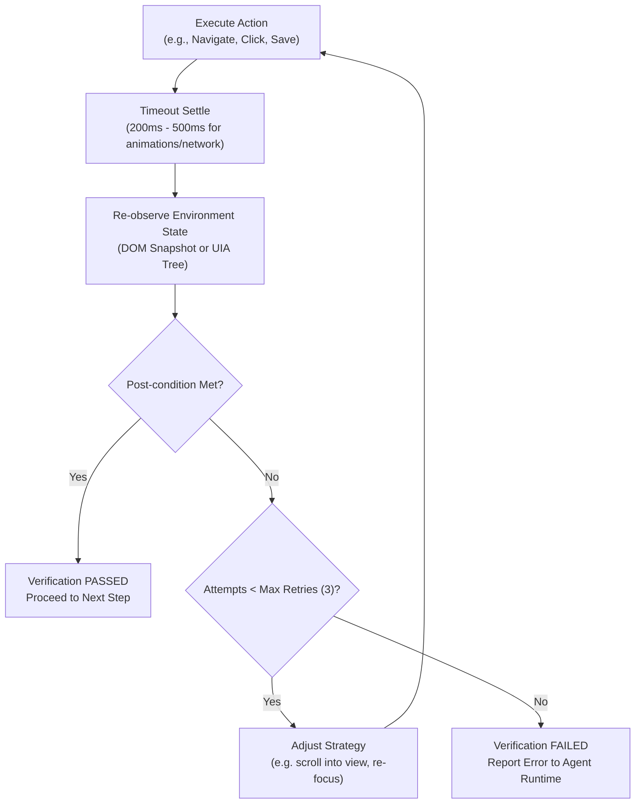

# Action Verification Specification & Post-Condition Engine
**Universal Autonomous AI Workspace — Phase 3**
**Subsystem:** Observe -> Interpret -> Act -> Verify Verification Pipeline

---

## 1. The Verification Requirement
In autonomous computer and browser automation, an action cannot be declared successful merely because the tool invocation returned without throwing an exception.
- A mouse click might register on a blank pixel if a dialog closed prematurely.
- A keystroke might type into the wrong window if focus shifted.
- A browser form submission might trigger a validation error without changing the page.

Therefore, Phase 3 mandates **Explicit Post-Condition Verification** for all desktop and web actions.

---

## 2. Verification Types & Post-Conditions

| Action Type | Typical Tool | Required Post-Condition | Verification Method |
|---|---|---|---|
| **Window Switch** | `windows_mcp_App(switch)` | Foreground window matches target | Query `GetForegroundWindow` / UIA active window |
| **App Launch** | `windows_mcp_App(launch)` | Process running and main window visible | Query process list + `WaitFor(window_name)` |
| **Desktop Save** | `windows_mcp_Shortcut(ctrl+s)` | Destination file exists and timestamp updated | Filesystem provider check on disk |
| **Web Navigation** | `browser_navigate` | Document URL matches target and title populated | Compare `browser_get_url` & document title |
| **Web Form Submit** | `browser_click(submit)` | Success banner visible OR URL redirection | Inspect DOM snapshot for success message / new path |
| **File Download** | `browser_click(download)` | Downloaded file exists with non-zero byte size | Check workspace downloads directory & verify checksum |
| **File Upload** | `browser_file_upload` | Input field reflects selected file name | DOM snapshot checks value attribute of file input |

---

## 3. Verification State Machine

---

## 4. Error Diagnostics & Failure Categorization
When verification fails after maximum retry attempts (default: 3), `ActionVerifier` categorizes the failure:
- **`TimeoutWaitingForCondition`**: The expected UI element or URL did not appear within the allotted time.
- **`ElementStateMismatch`**: The element exists but is disabled, read-only, or obscured.
- **`SessionInterrupted`**: Desktop ownership was reclaimed by the user during execution.
- **`PermissionDenied`**: The operation was rejected by the security engine or operating system.

These structured diagnostics allow the LLM to self-correct rather than looping endlessly.
