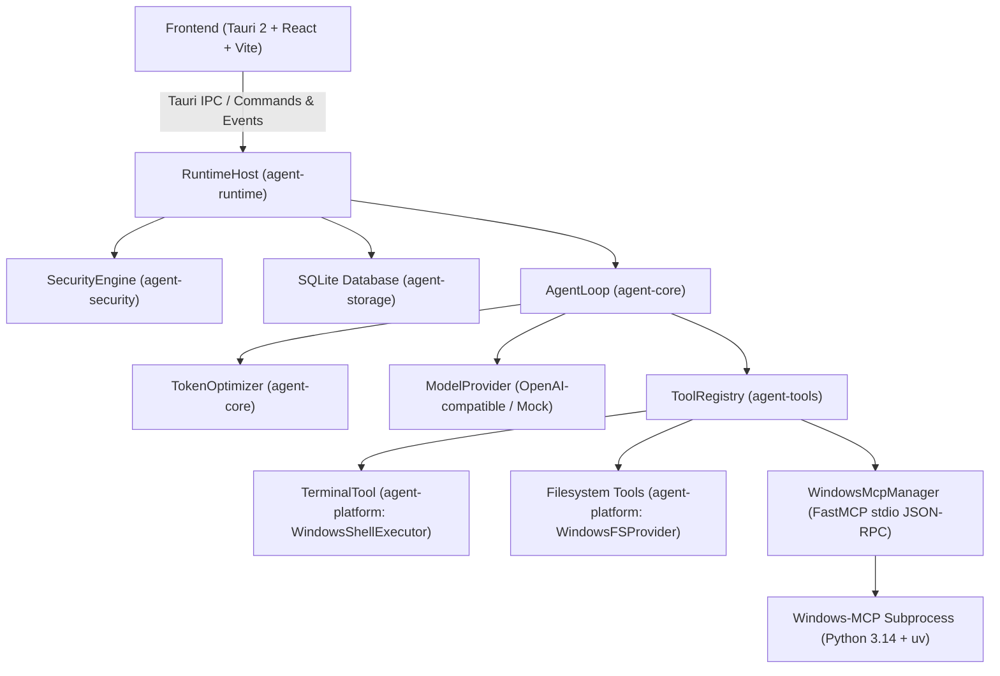

# Architecture Document — Universal Autonomous AI Workspace

## 1. System Overview

The **Universal Autonomous AI Workspace** is an agentic desktop application built for Windows first, designed from the ground up with cross-platform abstractions (Linux/macOS ready) and an open-source first architecture.

---

## 2. Multi-Crate Architecture

### A. `crates/agent-platform`
- Provides operating-system agnostic traits:
  * [`OperatingSystemAdapter`](file:///crates/agent-platform/src/traits.rs): System detection, prerequisite auditing, home/temp paths.
  * [`ShellExecutor`](file:///crates/agent-platform/src/traits.rs): Native process spawning with CMD, PowerShell, and streaming stdout/stderr readers.
  * [`FileSystemProvider`](file:///crates/agent-platform/src/traits.rs): Boundary validation and path canonicalization.
  * [`ComputerControlAdapter`](file:///crates/agent-platform/src/traits.rs): Desktop automation and screenshot interfaces.
  * [`CodingEngineAdapter`](file:///crates/agent-platform/src/traits.rs): Extension point for code-generation engines (such as OpenCode).
- Concrete Windows implementation in `crates/agent-platform/src/windows.rs`.
- Cross-platform stubs in `crates/agent-platform/src/stub.rs`.

### B. `crates/agent-security`
- [`SecurityEngine`](file:///crates/agent-security/src/lib.rs): Centralized permission enforcement.
- Tiers: `ReadOnly`, `WorkspaceWrite`, `ShellExecution`, `DesktopControl`, `DestructiveAction`, `ExternalSideEffect`.
- Modes: `Strict`, `WorkspaceAuto`, `FullAuto`.
- Scoped path sandbox: prevents operations outside designated workspace root unless authorized by human approval.
- Destructive command detection (`rmdir /s`, `format`, `shutdown`, `reg delete`, etc.).
- Global Emergency Stop mechanism.

### C. `crates/agent-storage`
- [`Database`](file:///crates/agent-storage/src/lib.rs): Embedded SQLite with Write-Ahead Logging (WAL) and foreign key constraints.
- Tables:
  * `conversations`: ID, title, token usage stats, timestamps.
  * `messages`: Conversation turns, roles, content, tool call IDs.
  * `tasks`: ID, status (`Pending`, `Running`, `WaitingApproval`, `Paused`, `Completed`, `Failed`, `Cancelled`), goal, current step, results.
  * `checkpoints`: Step-by-step state snapshots for crash recovery.
  * `tool_audit_logs`: Detailed execution trace, exit codes, durations, parameters, and outputs.

### D. `crates/agent-tools`
- [`ToolRegistry`](file:///crates/agent-tools/src/registry.rs): Dynamic registration and routing.
- Native Tools:
  * `terminal_execute`: Runs CMD or PowerShell with real-time buffer capture and timeout.
  * `file_read`: Line-paginated file reader with offset and limit.
  * `file_write`: Atomic write and append with directory creation.
  * `file_list`: Recursive directory traversal with metadata.
  * `file_search`: File name query and full-text content search.
  * `file_patch`: Search-and-replace block replacement with unified diff preview.
- [`WindowsMcpManager`](file:///crates/agent-tools/src/windows_mcp.rs):
  * Spawns Windows-MCP via `uv` over stdio JSON-RPC 2.0.
  * Performs handshake: `initialize` -> `notifications/initialized` -> `tools/list`.
  * Dynamic tool registration: maps all MCP tools directly into registry.

### E. `crates/agent-core`
- [`AgentLoop`](file:///crates/agent-core/src/agent_loop.rs): Multi-turn reasoning cycle:
  `Context Builder` -> `Model Request` -> `Tool Call Execution` -> `Validation & Truncation` -> `Checkpoint` -> `Next Step / Final Answer`.
- [`TokenOptimizer`](file:///crates/agent-core/src/token_optimizer.rs): Context budget allocation, tool output truncation, and history compaction.
- [`ModelProvider`](file:///crates/agent-core/src/model.rs): OpenAI-compatible API client and test mocks.

### F. `crates/agent-runtime`
- [`RuntimeHost`](file:///crates/agent-runtime/src/lib.rs): Thread-safe host orchestrating the database, tools, agent loops, active task handles, and broadcast event bus.
- Checkpoint Recovery Engine: Inspects database on boot and safely transitions interrupted tasks to `Paused` without hazardous blind replays.

### G. `apps/desktop`
- Tauri 2 host crate (`src-tauri`) exposing 20+ IPC commands.
- React 18 + TypeScript + Vite + Tailwind CSS frontend with 6 core screens.
