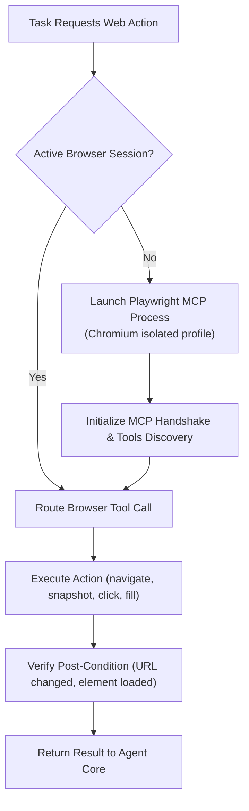

# Browser Automation Subsystem
**Universal Autonomous AI Workspace — Phase 3**
**Subsystem:** Playwright MCP Web Interaction, Navigation, and DOM Management

---

## 1. Architectural Role
The Browser Automation Subsystem provides native web navigation, multi-tab coordination, DOM interaction, form submission, and file transfer capabilities.

It integrates with **Playwright MCP** (`@playwright/mcp`) running over stdio JSON-RPC, supervised by the Rust core.

---

## 2. Browser Session Lifecycle

---

## 3. DOM Observation & Accessibility Snapshots

### 3.1 Structural Accessibility Tree
Instead of parsing raw, noisy HTML markup with stylesheets and scripts, the agent utilizes Playwright MCP's `browser_snapshot` tool:
- Returns an accessible tree containing semantic tags, roles (`button`, `link`, `textbox`, `combobox`), names, values, and assigned element reference IDs (`ref_id`).
- Guarantees deterministic element targeting for clicks and typing without brittle CSS selector paths.

### 3.2 Token Minimization
- **Tree Pruning**: Removes decorative layout elements and non-interactive wrappers.
- **Text Truncation**: Limits large text paragraphs unless specifically inspected.
- **Delta Snapshots**: On subsequent actions within the same page, only mutated subtrees are serialized into the conversation context.

---

## 4. Key Automation Workflows

### 4.1 Navigation & Verification
- `browser_navigate`: Opens destination URL, waiting for `networkidle` or `domcontentloaded`.
- Verification checks that the active page URL and document title match expected values.

### 4.2 Form Interaction
- Uses `browser_fill_form` or `browser_type` to fill target textboxes and `browser_select_option` for dropdowns.
- Submits forms via `browser_click` on submit buttons or dispatches Enter key events.

### 4.3 Safe File Transfers
- **Downloads**: Downloaded assets are directed strictly to the approved workspace downloads folder.
- **Uploads**: Restricts file selection exclusively to authorized files located within the project boundary.
