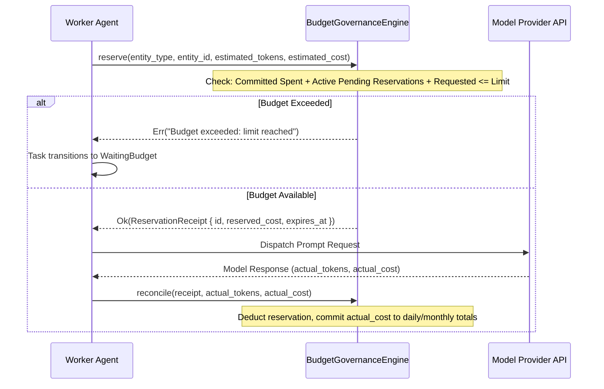

# Budget Governance & Pre-Request Token Reservation

## 1. Multi-Agent Budget Race Condition

In multi-agent systems with concurrent workers (e.g. Research Agent, Coding Agent, and Data Analyst all running simultaneously):
- If workers only check their budget *after* making LLM inference requests, multiple workers checking at the same time will all see sufficient remaining budget.
- Each worker dispatches large prompts simultaneously, causing cumulative expenditure to blow past daily, monthly, or workflow caps by hundreds of percent.

## 2. Pre-Request Reservation Architecture

To eliminate parallel budget races, `BudgetGovernanceEngine` enforces **two-phase budget allocation**:

## 3. Failure & Expiration Handling
- **Failure Before Sending:** If a network error or permission block occurs before reaching the model, the worker calls `engine.release(receipt.id)`. The reserved funds are instantly returned to the available pool.
- **Worker Hang / Crash:** Reservations include a 5-minute TTL (`expires_at`). Expired reservations are automatically purged during periodic cleanup cycles.
