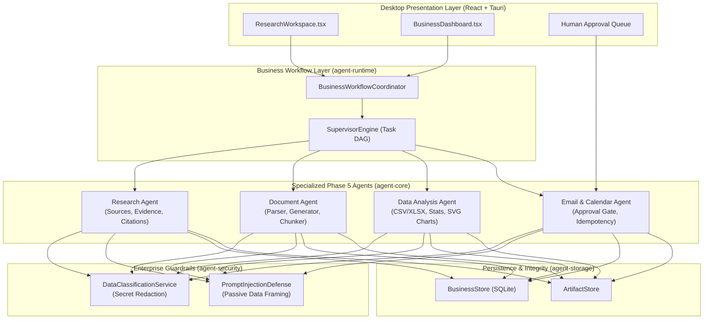

# Business & Research Automation Architecture
## Universal Autonomous AI Workspace — Phase 05

### 1. Executive Summary

Phase 05 expands the Universal Autonomous AI Workspace from engineering and computer automation into autonomous enterprise intelligence:
- **Research Agent**: Systematic web/local knowledge harvesting, source provenance, evidence extraction, citation graphing, and contradiction resolution.
- **Document Agent**: Robust multi-format document parser (PDF, DOCX, TXT, MD, HTML) and native OpenXML (`.docx`) and PDF 1.4 report generation without external Office licenses.
- **Data Analysis Agent**: Memory-efficient CSV and XLSX sheet streaming, statistical summaries (mean, median, std dev, min/max), group-by aggregations, IQR outlier detection, and SVG vector chart generation (bar and line).
- **Email & Calendar Agent**: Unified business connectors with rate limiting, exponential backoff, circuit breaking, idempotent operation IDs, and strict human-in-the-loop approval gating before external dispatch.
- **Business Workflow Coordinator**: Pre-packaged and dynamic business templates orchestrated via Phase 4's durable Task DAG (`SupervisorEngine`).

---

### 2. High-Level System Architecture

---

### 3. Core Architectural Subsystems

#### 3.1. Research Engine (`agent-core::research`)
- **Source Registry**: Catalogs web URLs, local files, and enterprise records with calculated SHA-256 fingerprints, HTTP etags, domain credibility tiers, and harvest timestamps.
- **Evidence Extraction**: Chunks extracted content and parses factual claims with direct offset bounds. Numeric claims are indexed for cross-source contradiction detection (flagging discrepancies > 15%).
- **Citation Graph & Report Generation**: Automatically maps numeric bracketed citations (`[1]`, `[2]`) in markdown outputs to persistent source records, ensuring zero ungrounded hallucination.

#### 3.2. Document Intelligence (`agent-core::document`)
- **DocumentParser**: Ingests PDF streams, OpenXML DOCX packages, Markdown, HTML, and plain text. Extracts structured metadata, headings, tables, and body paragraphs.
- **DocumentGenerator**: Native Rust generator:
  - Generates conformant ECMA-376 OpenXML `.docx` zip packages (`[Content_Types].xml`, `_rels/.rels`, `word/document.xml`, `word/_rels/document.xml.rels`) using the `zip` crate.
  - Generates valid PDF 1.4 files with xref tables, catalog, page dictionaries, and font streams.
- **DocumentChunker**: Structure-aware chunking preserving paragraph boundaries and heading hierarchy with configurable overlap.
- **DocumentVersionManager**: Content-hash-based snapshotting and unified visual diffing between document revisions.

#### 3.3. Deterministic Data Analysis (`agent-core::data`)
- **Code-First Computation**: Bypasses LLM hallucinations for all numeric math. All statistical metrics (mean, median, standard deviation, interquartile range) are computed deterministically in Rust.
- **SpreadsheetReader**: Streams CSV files with automatic delimiter detection (comma, tab, semicolon) and parses `.xlsx` OpenXML workbooks.
- **ChartGenerator**: Generates standalone, responsive vector SVG bar and line charts without requiring web rendering engines or external dependencies.

#### 3.4. Communication & Business Connectors (`agent-core::business`)
- **Unified Connector Registry**: Manages credentialed adapters with configurable rate limits (leaky bucket), automatic retry with exponential backoff, and 3-strike circuit breaking.
- **Human Approval Gate**: All external state mutations (sending emails, modifying calendar events) produce pending approval records in `business_approvals`. Execution is suspended until an operator explicitly approves the action via the UI.
- **Idempotency**: All dispatch payloads carry unique `operation_id` GUIDs stored in the SQLite ledger, preventing duplicate transmissions on network recovery.

---

### 4. Integration with Multi-Agent DAG Runtime

The `BusinessWorkflowCoordinator` translates high-level business goals into directed acyclic task graphs executed by `agent-runtime::SupervisorEngine`:

1. **Market Research**: Web/workspace research $\rightarrow$ Evidence extraction $\rightarrow$ Markdown report with citations $\rightarrow$ DOCX export.
2. **Data Reporting**: CSV/XLSX ingestion $\rightarrow$ Outlier & statistical analysis $\rightarrow$ SVG chart generation $\rightarrow$ Markdown & DOCX summary report.
3. **Email Assistance**: Search threads $\rightarrow$ Summarize interactions $\rightarrow$ Generate draft $\rightarrow$ Submit to Human Approval Gate.
4. **Research to Document**: Cross-source evidence synthesis $\rightarrow$ Verification $\rightarrow$ Document formatting $\rightarrow$ PDF/DOCX generation.
5. **Hybrid Business Pipeline**: Combined research, data calculation, chart generation, document compilation, and draft email generation for stakeholder distribution.

---

### 5. Security & Boundary Enforcement

1. **Information Flow Control**: Data is classified into `Public`, `Internal`, `Confidential`, and `Restricted`.
2. **Deterministic Redaction**: Pattern-matched credentials, API keys, passwords, and private tokens are masked to `[REDACTED_SECRET]` before hitting logs, LLM context, or external APIs.
3. **Untrusted Data Encapsulation**: External web data, email bodies, and document chunks are enclosed in `<UNTRUSTED_EXTERNAL_DATA>` tags with passive analysis instructions to completely neutralize prompt injection attacks.
