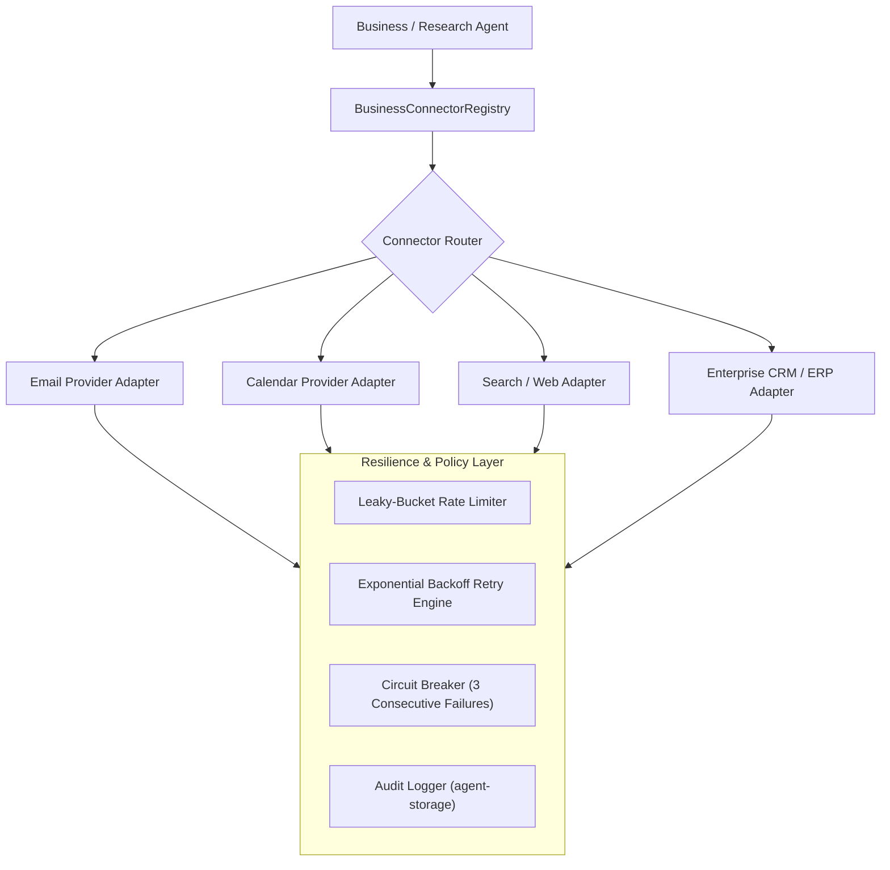

# Business Connector Architecture
## Universal Autonomous AI Workspace — Phase 05

### 1. Architectural Role

The **Business Connector Architecture** unifies external enterprise integrations (Email, Calendar, Storage, ERP, CRM) into a resilient, fault-tolerant, and secure pipeline managed by `agent-core::business::BusinessConnectorRegistry`.

---

### 2. Connector Architecture & Protection Layer

---

### 3. Key Reliability Mechanisms

#### 3.1. Rate Limiting (Leaky Bucket)
- Each connector is assigned a maximum requests-per-minute threshold (e.g., 60 req/min for web APIs, 30 req/min for mail servers).
- Invocations exceeding the rate are queued in Tokio async channels rather than dropped, eliminating `429 Too Many Requests` API penalties.

#### 3.2. Exponential Backoff & Jitter
When transient network issues (e.g., HTTP 503, connection timeouts) occur, the connector retries with randomized exponential backoff:
$$T_{wait} = \min(T_{max}, T_{base} \times 2^{\text{attempt}}) \pm \text{jitter}$$
- Prevents the "thundering herd" problem when enterprise services recover.

#### 3.3. Circuit Breaker Pattern
- Connectors track consecutive failure counts.
- After 3 consecutive unrecoverable failures, the circuit transitions from `Closed` to `Open`.
- In the `Open` state, calls fail fast immediately without tying up agent runtime threads.
- After a configurable cooldown interval (e.g. 60 seconds), the circuit enters `Half-Open` to probe connectivity with a single test call.

---

### 4. Connector Credential & Secrets Management

1. **Zero Plaintext Storage**: Connector credentials (API tokens, OAuth refresh tokens, SMTP passwords) are never stored in plain text.
2. **Encrypted Storage**: Secrets are stored in SQLite using authenticated encryption or Windows DPAPI / credential vault.
3. **In-Memory Masking**: The `SecretRedactor` service scrubs credential strings from logs, error backtraces, and LLM payloads before they exit the connector boundary.
