# Business Workflows & Execution Templates
## Universal Autonomous AI Workspace — Phase 05

### 1. Workflow Orchestration Overview

The **Business Workflow Coordinator** (`agent-runtime::business_coordinator::BusinessWorkflowCoordinator`) operationalizes multi-agent business automation. Rather than requiring users to manually chain prompts, it orchestrates standard and custom workflows directly onto Phase 4's durable `TaskDag` and `SupervisorEngine`.

---

### 2. Built-in Workflow Templates

```mermaid
flowchart TD
    subgraph T1["1. Market & Competitive Research"]
        T1A["Web / Workspace Search"] --> T1B["Evidence Extraction & Fact-Checking"]
        T1B --> T1C["Discrepancy & Contradiction Resolution"]
        T1C --> T1D["Executive Markdown & DOCX Report with Citations"]
    end

    subgraph T2["2. Data Analysis & Financial Reporting"]
        T2A["Ingest CSV / XLSX Spreadsheet"] --> T2B["Statistical Summaries & IQR Outlier Filter"]
        T2B --> T2C["Group-By Categorical Aggregations"]
        T2C --> T2D["Generate Responsive SVG Vector Charts"]
        T2D --> T2E["Compile Structured Performance Brief"]
    end

    subgraph T3["3. Email Intelligence & Drafting"]
        T3A["Search Thread & Extract Context"] --> T3B["Synthesize Discussion History"]
        T3B --> T3C["Generate Polished Email Draft"]
        T3C --> T3D["Queue in Human Approval Gate"]
    end

    subgraph T4["4. Document Ingestion & Verification"]
        T4A["Parse Multi-Format Document (PDF/DOCX)"] --> T4B["Semantic Structure-Aware Chunking"]
        T4B --> T4C["Extract Core Propositions & Claims"]
        T4C --> T4D["Cross-Verify Against Knowledge Base"]
    end

    subgraph T5["5. Hybrid End-to-End Enterprise Pipeline"]
        T5A["Market Research"] --> T5B["Ingest Metrics & Generate Charts"]
        T5B --> T5C["Synthesize DOCX Executive Brief"]
        T5C --> T5D["Prepare Outbound Email with Brief"]
        T5D --> T5E["Human Review & Final Dispatch"]
    end
```

---

### 3. Template Specification

#### 3.1. Market Research Workflow (`market_research`)
- **Agents**: Research Agent $\rightarrow$ Document Agent.
- **Inputs**: Research topic, target domains/sources, citation requirement.
- **Outputs**: Verified evidence records, Markdown summary, OpenXML `.docx` report.

#### 3.2. Data Reporting Workflow (`data_reporting`)
- **Agents**: Data Analysis Agent $\rightarrow$ Document Agent.
- **Inputs**: Path to CSV/XLSX file, target metrics, grouping dimensions.
- **Outputs**: Mean/Median/StdDev table, Outlier list, SVG Bar/Line charts, Markdown brief.

#### 3.3. Email Assistance Workflow (`email_assistance`)
- **Agents**: Email Agent.
- **Inputs**: Thread ID or subject query, communication objective, recipient email.
- **Outputs**: Thread synthesis, drafted email, approval record.

#### 3.4. Research-to-Document Workflow (`research_to_document`)
- **Agents**: Research Agent $\rightarrow$ Data Analysis Agent $\rightarrow$ Document Agent.
- **Inputs**: Topic, dataset paths, document formatting template.
- **Outputs**: Comprehensive cited whitepaper in Markdown, DOCX, and PDF formats.

#### 3.5. Hybrid Pipeline Workflow (`hybrid_pipeline`)
- **Agents**: Supervisor $\rightarrow$ Research $\rightarrow$ Data $\rightarrow$ Document $\rightarrow$ Email.
- **Inputs**: Multi-faceted business objective (e.g. "Prepare Q3 Market Review, analyze sales.csv, create chart, and draft notification to leadership").
- **Outputs**: Multi-stage DAG task execution, combined deliverables, pending approval for final distribution.

---

### 4. Resumption & Fault Tolerance

Because business workflows execute on the Phase 4 Task DAG:
- Each task step is persisted in SQLite with state transitions (`Pending` $\rightarrow$ `Running` $\rightarrow$ `Completed` / `Failed`).
- If an agent crashes or the desktop application is closed during a long-running research task, execution resumes from the last completed DAG checkpoint upon relaunch.
