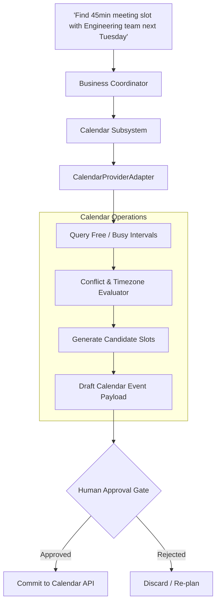

# Calendar Integration Architecture
## Universal Autonomous AI Workspace — Phase 05

### 1. Purpose & Capabilities

The **Calendar Subsystem** enables autonomous time coordination, scheduling analysis, conflict detection, and meeting proposal preparation. It complements the Email Agent by bridging communication with temporal availability.

---

### 2. Architecture & Data Flow



---

### 3. Core Capabilities (`agent-core::business::calendar`)

#### 3.1. Free/Busy Calculation & Multi-Timezone Normalization
- Queries calendar ranges across multiple internal and external attendees.
- Normalizes all time records to UTC timestamps internally, presenting localized times to the user in their preferred timezone.
- Enforces working hour constraints (e.g., 09:00 - 18:00 local time) and respects existing calendar blocks.

#### 3.2. Conflict Detection Algorithm
- Scans candidate meeting windows against all participant calendars.
- Identifies overlaps, buffer travel times, and recurring series conflicts.
- Proposes prioritized candidate slots ranked by participant preference and schedule density.

#### 3.3. Approval-Gated Event Mutation
Creating, updating, or deleting calendar invitations follows the same enterprise security protocol as sending emails:
1. Event modifications are recorded as pending approvals in `business_approvals`.
2. The UI renders the proposed title, start/end times, attendee list, and agenda description.
3. Upon human approval, the adapter dispatches the mutation.

---

### 4. Adapter Interface

The `CalendarProviderAdapter` trait defines:
```rust
pub trait CalendarProviderAdapter: Send + Sync {
    fn query_events(&self, account_id: &str, start_ts: i64, end_ts: i64) -> Result<Vec<CalendarEvent>, String>;
    fn check_availability(&self, account_id: &str, start_ts: i64, end_ts: i64) -> Result<bool, String>;
    fn propose_meeting(&self, account_id: &str, proposal: &MeetingProposal) -> Result<String, String>;
    fn commit_event(&self, account_id: &str, approval_id: &str) -> Result<CalendarEvent, String>;
}
```

Implementations include `MockTestCalendarProvider` for comprehensive offline testing and future Microsoft Outlook / Google Calendar cloud connectors.
