# Advanced Autonomous Coding Agent: Architecture Specification

## 1. Executive Summary & Vision

The **Phase 2 Advanced Autonomous Coding Agent** transforms the Universal Autonomous AI Workspace from a general assistant into an autonomous software engineering system. Built natively in Rust with a modern React 18 / Tauri 2 interface, the Coding Agent can independently discover project structures, comprehend multi-language codebases (Rust, TypeScript/JavaScript, Python, C/C++), formulate implementation plans, execute safe atomic code mutations, trigger builds and test runners, parse compiler diagnostics, and perform self-correction loops.

---

## 2. System Architecture

```mermaid
flowchart TD
    subgraph UI ["Desktop UI (React 18 + Tailwind)"]
        CW["Coding Workspace"]
        CW_Tabs["Code Viewer | Diff Inspector | Plan Steps | Problems Panel"]
        CW_Modes["Mode Switcher: Ask | Plan | Build"]
    end

    subgraph Host ["Tauri 2 Host Layer (apps/desktop/src-tauri)"]
        IPC["IPC Command & Event Bridge"]
        HostState["AppState (RuntimeHost)"]
    end

    subgraph Core ["Agent Core & Runtime (agent-core & agent-runtime)"]
        RT["RuntimeHost Supervisor"]
        CWE["CodingWorkflowEngine"]
        Modes["CodingMode Dispatcher"]
        Loop["Agent Loop & Tool Dispatcher"]
        DiagDedup["Diagnostic Deduplicator & Root Cause Extractor"]
        TokenOpt["Token Optimizer & Compact Repo Map"]
    end

    subgraph Tools ["Tool Registry (agent-tools)"]
        Git["Git Tools: status, diff, log, commit"]
        Intel["Code Intelligence: project_detect, repo_map, code_search, file_outline"]
        Edit["Mutation: code_edit, code_patch, diff_preview"]
        Build["Build & Test: run_build, run_test"]
    end

    subgraph Safety ["Security & Sandbox (agent-security)"]
        SecEngine["SecurityEngine & PermissionEngine"]
        Sandbox["Scoped Workspace Boundary Enforcement"]
        Emergency["Emergency Stop & Approval Gates"]
    end

    subgraph OS ["Host Operating System & Toolchains"]
        Compilers["Cargo (Rust) | TSC/NPM (TS/JS) | Python/Pytest | CMake/GCC"]
        VCS["Git CLI (Working Tree)"]
    end

    UI --> Host
    Host --> Core
    Core --> Tools
    Tools --> Safety
    Safety --> OS
```

---

## 3. Core Architectural Modules

### 3.1 Layered Decomposition

1. **Presentation Layer (`apps/desktop/src/components/CodingWorkspace.tsx`)**:
   - Multi-tab developer workspace with Source Viewer, Unified Diff Inspector, Step Tracker, and Problems Panel.
   - Mode switcher allowing users to toggle between `Ask` (explanation), `Plan` (planning), and `Build` (autonomous execution).
   - Live compiler status with error/warning badges and jump-to-code navigation.
2. **Runtime Supervisor (`crates/agent-runtime`)**:
   - Manages asynchronous task lifecycle, event streaming, SQLite persistence, and checkpoint recovery.
   - Exposes high-level coding APIs (`detect_project`, `get_repo_map`, `preview_diff`, `run_build`, `run_test`, `start_coding_task`).
3. **Workflow Engine (`crates/agent-core/src/coding_loop.rs`)**:
   - Injects OpenCode-style `<env>` blocks containing workspace path, primary language, build system, test runner, and git branch.
   - Selects allowed tools based on active `CodingMode` to enforce read-only isolation in `Ask` and `Plan` modes.
4. **Tool Registry (`crates/agent-tools`)**:
   - `CodeEditTool`: OpenCode-style exact-string replacement with uniqueness verification and quote normalization.
   - `CodePatchTool`: Atomic multi-file patch with automatic rollback if any write or permission fails.
   - `RepoMapTool`: Compact symbol-aware hierarchical map within strict token/character budgets.
   - `CodeSearchTool`: Fast regex/pattern search skipping build directories (`target`, `node_modules`, `.git`).
   - `BuildRunnerTool` & `TestRunnerTool`: Direct compiler invocation and structured diagnostic parsing.
5. **Platform & Language Adapters (`crates/agent-platform/src/language.rs`)**:
   - `MultiLanguageAdapter`: Implements automated detection and compiler output parsing for Rust (`rustc`), TypeScript (`tsc`), Python (`pytest`, `SyntaxError`), and generic compilers.

---

## 4. OpenCode Architectural Integration

In accordance with the Open-Source-First philosophy, the Coding Agent adopts proven design patterns from **OpenCode** (MIT License):
- **Exact-Match Text Mutation**: Eliminates hallucinated entire-file overwrites by replacing exact `old_string` substrings.
- **Normalization Engine**: Handles Unicode quote variations, em-dashes, and non-breaking spaces gracefully.
- **Atomic Multi-Hunk Rollback**: Captures pre-patch disk snapshots in memory; rolls back all files if an intermediate hunk fails.
- **Hierarchical Compaction**: Summarizes older conversation steps while maintaining recent turns verbatim to strictly enforce token budgets.

---

## 5. Security & Safety Model

- **Scoped Workspace Boundary**: All tool file accesses are verified against the active workspace root. Attempts to access parent directories (`../`) are intercepted and rejected.
- **Working Tree Integrity**: Destructive commands (`git reset --hard`, `git clean -f`, force push) are barred from automatic execution without explicit human authorization.
- **Rollback Protection**: Files modified during an atomic patch are restored if validation fails, preventing corrupted project states.
