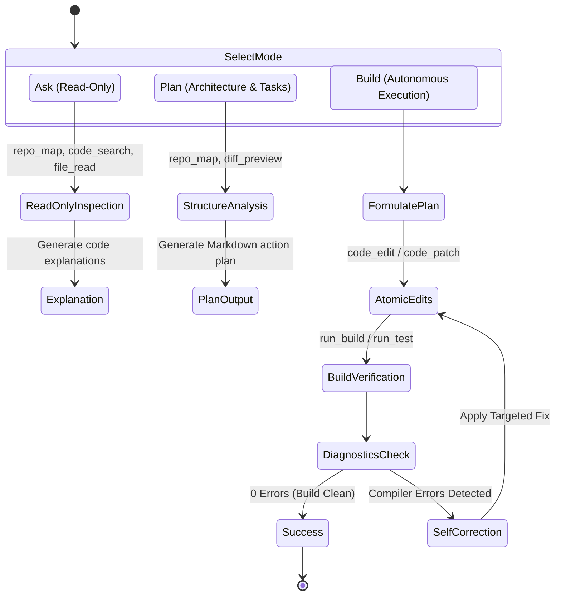

# Autonomous Coding Workflow & Execution Modes

## 1. Overview
The Phase 2 Autonomous Coding Agent operates across three specialized, distinct execution modes inspired by OpenCode: **Ask**, **Plan**, and **Build**. Each mode provides tailored system prompt instructions and selective tool filtering to guarantee safety and clarity.

---

## 2. Execution Modes

### 2.1 Ask Mode (Read-Only Comprehension)
- **Goal**: Answer technical questions, explain software architectures, trace functions across files, and provide code walkthroughs without mutating disk state.
- **Allowed Tools**:
  - `repo_map`: Compact symbol index.
  - `code_search`: Ripgrep-like pattern search.
  - `file_outline`: File symbol listings.
  - `file_read`, `file_list`: Safe read-only filesystem access.
  - `git_status`, `git_log`: Repository inspection.
- **Forbidden Tools**: `code_edit`, `code_patch`, `run_build`, `terminal_execute` (prevents unexpected writes).

### 2.2 Plan Mode (Implementation Planning)
- **Goal**: Formulate structured implementation strategies, evaluate affected modules, and produce step-by-step checklists before executing code modifications.
- **Allowed Tools**: All Ask mode tools + `diff_preview` (allows simulated diff generation without writing to disk).
- **Behavior**: Emits `AgentEvent::CodingPlanCreated` containing targeted files, proposed changes, and verification milestones.

### 2.3 Build Mode (Autonomous Implementation & Self-Correction)
- **Goal**: Fully autonomous end-to-end coding: formulate plan, execute atomic edits, invoke compiler/typechecker, parse diagnostics, and iteratively self-correct until all builds and tests succeed.
- **Allowed Tools**: All tools enabled (`code_edit`, `code_patch`, `run_build`, `run_test`, `terminal_execute`, `git_commit`).

---

## 3. The Autonomous Self-Correction Loop

When in `Build` mode, the agent follows a closed-loop repair cycle:

1. **Mutation**:
   - The agent applies precise code modifications using `code_edit` (matching exact `old_string` context) or `code_patch` (atomic batching).
   - In-memory backup snapshots are taken before writing to disk.
2. **Compilation**:
   - The agent triggers `run_build`. The host runs `cargo check`, `npm run build`, or `python -m py_compile`.
3. **Diagnostic Extraction & Deduplication**:
   - `MultiLanguageAdapter::parse_diagnostics()` extracts structured file, line, column, code, and severity information.
   - `deduplicate_diagnostics()` filters out repetitive cascading errors at the same source site, keeping the primary root cause error in focus and saving up to 85% of LLM tokens.
4. **Targeted Repair**:
   - If errors exist, the agent receives the compact root cause prompt and applies a targeted fix via `code_edit`.
5. **Re-Verification**:
   - The compiler runs again. Once `total_errors == 0`, tests are invoked via `run_test`.
6. **Delivery**:
   - A final completion report is delivered with unified diffs and verification logs.
