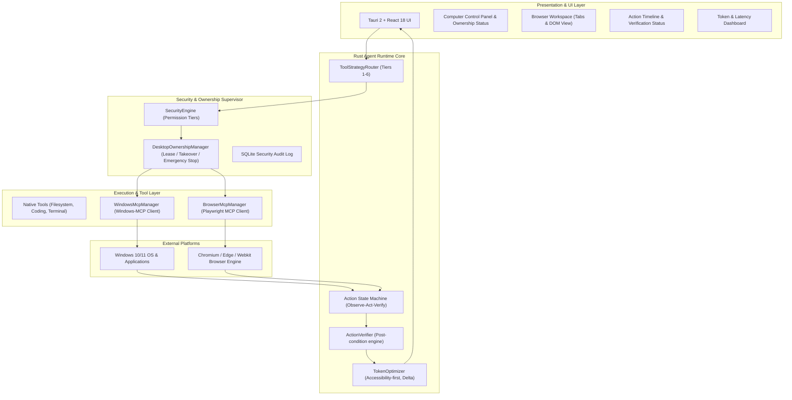
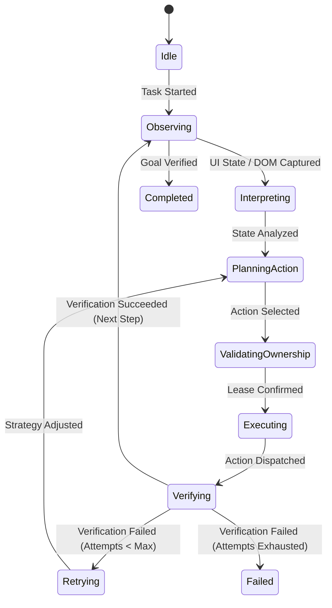

# Computer & Browser Agent Architecture
**Universal Autonomous AI Workspace — Phase 3**
**Target OS:** Windows 10/11 | **Cross-Platform Ready:** Linux & macOS

---

## 1. System Vision
The Advanced Computer & Browser Agent enables autonomous, multi-step computer tasks by combining:
- **Direct OS & Application Control**: via Windows-MCP and native Win32/UIA interfaces.
- **Modern Web Automation**: via Playwright MCP with headless and interactive browser contexts.
- **Intelligent Tool Strategy Routing**: choosing Direct APIs, Shell/CLI, Coding Agent, Browser MCP, and Windows-MCP based on efficiency and reliability.
- **Deterministic Observe-Act-Verify Loop**: validating explicit post-conditions after every interaction.
- **Desktop Ownership Manager**: maintaining safe single-controller leases and instant user takeover.
- **Token Efficiency First**: replacing full-page screenshots with structured accessibility and DOM trees.

---

## 2. Layered Architecture

---

## 3. Core Subsystems

### 3.1 Smart Tool Strategy Router
Evaluates incoming goals and delegates tasks according to a strict priority hierarchy:
1. **Tier 1 — Direct API**: If an official REST/gRPC API is available, invoke it directly (lowest token cost, highest speed).
2. **Tier 2 — Filesystem / SQLite**: For reading, editing, searching files or querying databases, use native Rust file tools.
3. **Tier 3 — Shell / CLI / Coding Agent**: For compilation, testing, package management, git, use terminal or coding engines.
4. **Tier 4 — Browser Automation (Playwright MCP)**: For web research, form submissions, web applications, use DOM accessibility tree interaction.
5. **Tier 5 — Windows UI Automation (Windows-MCP)**: For desktop apps (Notepad, Office, IDEs, system settings), use UI automation trees and window switching.
6. **Tier 6 — Vision / Screenshot**: Visual recognition is only used when accessibility nodes are absent (e.g. canvas elements, game viewports).

### 3.2 Observe -> Interpret -> Act -> Verify State Machine
Every action progresses through a deterministic lifecycle:

### 3.3 Desktop Ownership Management
- The AI never shares interactive input control simultaneously with the human user.
- **Lease Mechanism**: The AI requests a timed lease (10–30s).
- **User Takeover**: If the user moves the mouse or types, the lease is immediately revoked, and AI actions are paused or aborted.
- **Emergency Stop**: Releases all active leases, kills active MCP action routines, and returns the system to a clean state.
