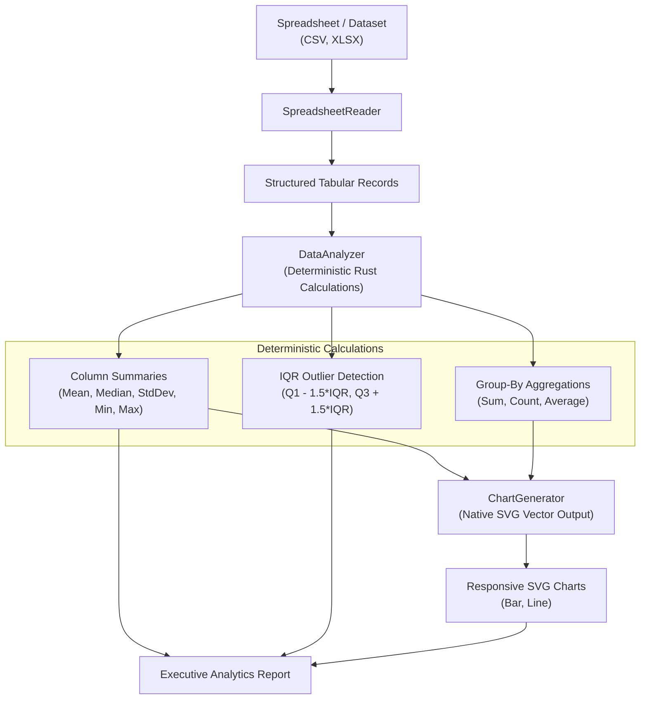

# Data Analysis Agent Architecture
## Universal Autonomous AI Workspace — Phase 05

### 1. Purpose & Philosophy

Language models are notoriously prone to arithmetic errors, hallucinated statistical aggregations, and imprecise numeric evaluations. The **Data Analysis Agent** enforces a **Code-First Computational Philosophy**:

> **Core Rule**: LLMs formulate analytical plans and interpret high-level business findings, but **100% of mathematical calculations, statistical summaries, aggregations, and chart visualizations are executed deterministically in native Rust code**.

---

### 2. Capabilities & Architecture (`agent-core::data`)

---

### 3. Key Analytical Functions

#### 3.1. Statistical Column Summaries
Calculates exact distributions for all numeric columns:
- **Count & Null Count**: Valid data points vs. missing values.
- **Min & Max**: Extrema bounds.
- **Mean**: Arithmetic average: $\bar{x} = \frac{1}{n}\sum_{i=1}^n x_i$.
- **Median**: Precise 50th percentile (sorted middle value).
- **Standard Deviation**: Sample standard deviation: $s = \sqrt{\frac{1}{n-1}\sum_{i=1}^n (x_i - \bar{x})^2}$.

#### 3.2. Outlier Detection (Interquartile Range)
Identifies anomalies using standard Tukey fences:
1. Calculates 25th percentile ($Q_1$) and 75th percentile ($Q_3$).
2. Computes the Interquartile Range: $IQR = Q_3 - Q_1$.
3. Classifies any point $x$ as an outlier if:
   $$x < Q_1 - 1.5 \times IQR \quad \text{or} \quad x > Q_3 + 1.5 \times IQR$$

#### 3.3. Multi-Level Grouping & Aggregations
Supports categorical breakdown (e.g. revenue by region, transactions by month) with:
- Sum, Mean, Count, and Percentage-of-Total metrics.

---

### 4. Vector SVG Chart Generation

Rather than calling external chart libraries or heavy browser headless renderers, `ChartGenerator` produces clean, standards-compliant, responsive SVG code directly from Rust:

- **Bar Charts**:
  - Automatically scales Y-axis based on dataset maximum.
  - Dynamically calculates bar widths, gaps, and categorical X-axis labels.
  - Generates gridlines, value labels, and hover-friendly styling.
- **Line Charts**:
  - Calculates coordinate trajectories across multi-point time series.
  - Generates smooth polyline segments, data markers, and axis intervals.
- **Theming**: Adheres to modern dark/light UI palette (`#89b4fa` primary accent, `#45475a` gridlines, `#cdd6f4` text labels).
