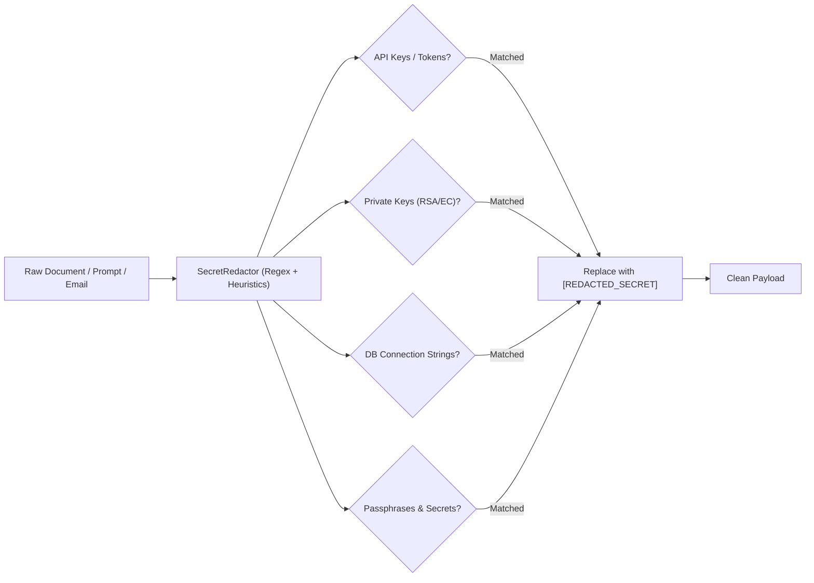

# Enterprise Data Classification
## Universal Autonomous AI Workspace — Phase 05

### 1. Classification Model

To safeguard sensitive corporate and customer information during automated processing, Phase 05 establishes a 4-tier data classification hierarchy (`agent-security::data_classification::DataClassification`):

| Classification Tier | Definition | Handling & Egress Rules |
|---|---|---|
| **`Public`** | Unrestricted external information (e.g. open web pages, public docs, marketing assets) | May be processed by all agents, sent to external LLMs, or cached without encryption. |
| **`Internal`** | Company/workspace proprietary information (internal documentation, non-sensitive tickets) | May be processed across local agents and trusted enterprise LLM endpoints. |
| **`Confidential`** | Business-critical data (financial models, customer rosters, contracts, source code) | Requires explicit user project permission; secret redaction strictly enforced; local audit logged. |
| **`Restricted`** | Highly sensitive data (passwords, private keys, API secrets, PII, payment info) | **Strictly prohibited** from leaving the host machine; blocked from external LLMs; automatically redacted to `[REDACTED_SECRET]`. |

---

### 2. Secret Redaction Engine (`SecretRedactor`)

The `SecretRedactor` runs deterministically on every text payload before it is written to logs, stored in artifacts, or submitted to LLMs:

#### Monitored Secret Patterns:
- API Keys: AWS access keys, GitHub personal access tokens, OpenAI/Anthropic keys (`sk-...`), Slack tokens.
- Private Keys: `-----BEGIN (RSA|EC|OPENSSH) PRIVATE KEY-----`.
- Connection Strings: `postgres://`, `mysql://`, `mongodb://` containing embedded credentials.
- Generic Password Assignments: `password = "..."`, `secret: "..."`.

---

### 3. Classification Propagation

When documents, emails, or spreadsheets are processed:
1. Each data source inherits an initial classification level based on path or connector configuration.
2. If multiple sources are aggregated into a single research report, the combined artifact automatically inherits the **highest (most restrictive)** classification level among all constituent inputs:
   $$\text{Classification}(\text{Artifact}) = \max_{s \in \text{Sources}}(\text{Classification}(s))$$
3. Restricted data cannot be downgraded without manual cryptographic administrative override.
