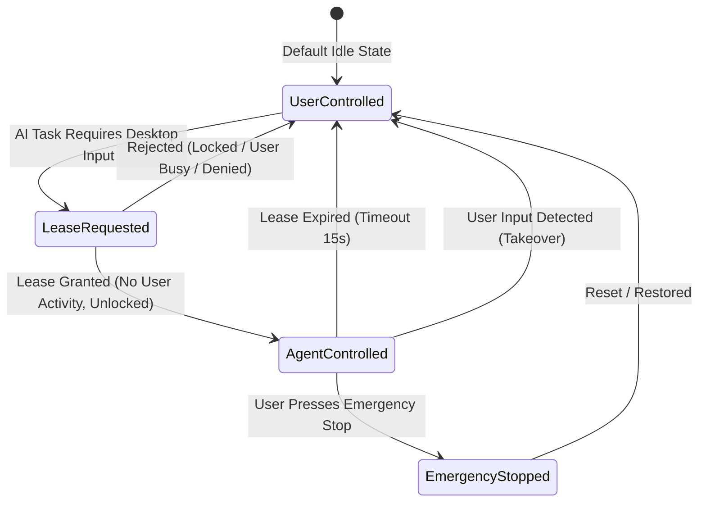

# Desktop Session Model & Ownership Specification
**Universal Autonomous AI Workspace — Phase 3**
**Subsystem:** Interactive Desktop Controller & Safety Supervisor

---

## 1. Principles of Desktop Ownership
Unlike headless backend tasks or autonomous coding loops that operate strictly within file sandboxes, Desktop Automation interacts directly with the user's interactive desktop session (display, keyboard, mouse cursor, window focus).

To prevent disruptive or hazardous interference, Phase 3 implements the **Single-Controller Lease Model**:
- At any given moment, the interactive desktop has exactly **one** primary controller: either the **User** or the **Agent**.
- The Agent cannot simulate inputs without holding an active lease.
- The User possesses preemptive override authority at all times.

---

## 2. Desktop Ownership Lifecycle

### 2.1 State Definitions
1. **`UserControlled`**:
   The human user has exclusive control of the mouse, keyboard, and foreground windows. Any attempt by the AI to dispatch mouse or keyboard events is blocked.
2. **`AgentControlled`**:
   The AI holds a time-bounded lease (`AgentLease`). It is authorized to dispatch mouse clicks, keystrokes, and window focus commands. An on-screen visual indicator (or banner in the UI) confirms active AI control.
3. **`UserTakeover`**:
   If user physical input is detected while the AI is executing a step, the lease is instantly revoked. The active step is aborted or paused, and ownership returns to the user.
4. **`EmergencyStopped`**:
   Triggered via the desktop UI Emergency Stop button or global hotkey. All active subprocesses are halted, active leases are cancelled, and the input synthesis queue is drained.

---

## 3. Workstation Lock & Security States

The agent continuously queries the desktop session state before performing UI actions:
- **`Unlocked`**: Normal interactive session. GUI automation proceeds if lease is granted.
- **`Locked`**: Screen is locked (`LockWorkstation`), screensaver is active, or UAC secure desktop is displayed.
  - GUI automation tools (`Click`, `Type`, `Shortcut`) are immediately prevented.
  - The agent logs: `"Desktop is currently locked. Suspending GUI interaction."`
  - Non-GUI tasks (background shell commands, filesystem searches, headless tests) are allowed to continue if authorized.
- **`Disconnected / Headless`**: Remote desktop session disconnected or run in headless mode. Falls back to headless browser automation or direct CLI tools.
