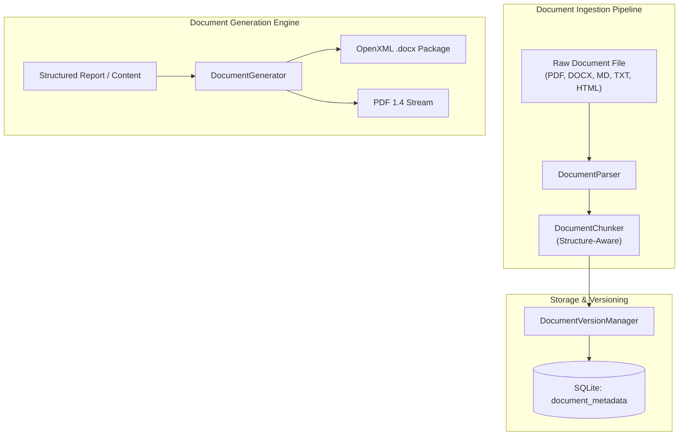

# Document Agent Architecture
## Universal Autonomous AI Workspace — Phase 05

### 1. Purpose & Capabilities

The **Document Agent** manages the lifecycle of business documents, technical reports, and specifications. It operates bidirectionally:
1. **Ingestion & Extraction**: Parses complex multi-format documents (PDF, DOCX, TXT, MD, HTML), extracting clean text, hierarchical sections, and structured metadata.
2. **Generation & Exporting**: Produces professional executive deliverables in OpenXML (`.docx`) and PDF 1.4 formats directly from Rust without requiring Microsoft Word, LibreOffice, or external cloud APIs.
3. **Chunking & Indexing**: Employs structure-aware chunking that respects paragraph and heading boundaries for token-efficient LLM consumption.
4. **Version Management**: Tracks document revisions, content hashes, and diffs to ensure change traceability.

---

### 2. High-Level Architecture (`agent-core::document`)

---

### 3. Native OpenXML (.docx) Generation

Unlike typical AI tools that shell out to Python scripts or external binaries, Phase 05 incorporates a native ECMA-376 OpenXML packager using Rust's `zip` crate:

#### Package File Structure:
- `[Content_Types].xml`: Defines MIME types for XML parts and relationships.
- `_rels/.rels`: Global package relationships.
- `word/document.xml`: Body content with XML-escaped paragraphs (`<w:p>`), runs (`<w:r>`), text nodes (`<w:t>`), headings, bolding (`<w:b/>`), and table structures (`<w:tbl>`).
- `word/_rels/document.xml.rels`: Document-level relationship mappings.

This produces standard `.docx` files fully compatible with Microsoft Word, LibreOffice Writer, Google Docs, and macOS Pages.

---

### 4. Native PDF 1.4 Stream Generation

For fast, zero-dependency PDF output, `DocumentGenerator::generate_pdf`:
- Builds conformant PDF 1.4 binary streams directly in memory.
- Constructs standard PDF catalog dictionaries (`/Type /Catalog`, `/Pages`).
- Configures font resources (standard Helvetica/Arial metrics).
- Emits text streams using PDF operators (`BT`, `/F1 12 Tf`, `TL`, `T*`, `Tj`, `ET`).
- Generates exact byte-offset cross-reference tables (`xref`) and file trailers with `/Root` and `/Size`.
- Validated to render cleanly in standard PDF viewers (Adobe Acrobat, Chrome PDF Viewer, Foxit).

---

### 5. Document Version Management & Diffs

The `DocumentVersionManager`:
- Computes SHA-256 fingerprints of document contents.
- Assigns sequential version numbers (`v1`, `v2`, `v3`).
- Tracks author (agent or human), creation timestamp, and summary of modifications.
- Implements text-based unified diffing to inspect edits made across workflow iterations.
