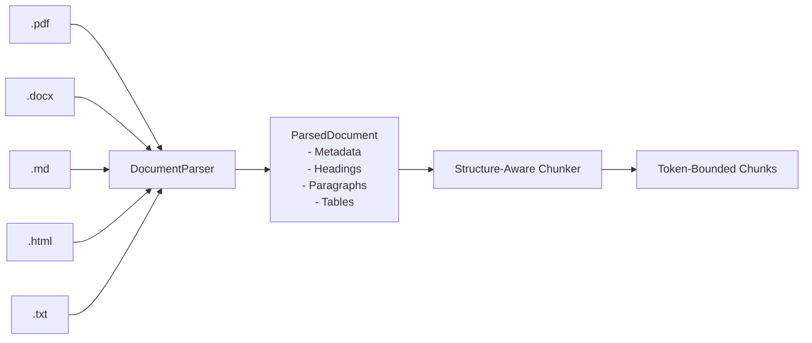

# Document Processing Pipeline
## Universal Autonomous AI Workspace — Phase 05

### 1. Ingestion & Format Normalization

The Document Processing Pipeline accepts diverse file formats and normalizes them into structured documents with consistent hierarchical sections.

#### Supported Formats:
- **Plain Text & Markdown (`.txt`, `.md`)**: Direct UTF-8 ingestion; Markdown AST parsing for headings (`#`, `##`), bullet points, tables, and code fences.
- **HTML (`.html`, `.htm`)**: Tag stripping, link extraction, table parsing into markdown table syntax.
- **DOCX (`.docx`)**: Unzips package, extracts and decodes XML text from `word/document.xml`, extracting headings based on paragraph styles.
- **PDF (`.pdf`)**: Extracts raw text blocks and streams, normalizing whitespace and line breaks.

---

### 2. Structure-Aware Chunking

Naïve fixed-character or fixed-token chunking cuts sentences and code blocks in half, destroying semantic coherence. `DocumentChunker` uses a **structure-aware, semantic boundary** strategy:

1. **Hierarchy Preservation**: Chunks are split at major section headers (`H1`, `H2`) first.
2. **Paragraph Cohesion**: Text within sections is segmented by paragraph breaks (`\n\n`).
3. **Token Budgets**: Chunks accumulate paragraphs until reaching the target window size (e.g. 500–1,000 tokens).
4. **Boundary Overlap**: A configurable overlap (default 100 tokens) carries forward the previous sentence to maintain contextual continuity across chunk boundaries.
5. **Breadcrumb Metadata**: Each chunk retains metadata indicating its parent document, section title, and sequential index.

---

### 3. Pipeline Security & Sanitization

Documents received from external parties (suppliers, emails, public links) represent potential vectors for prompt injection or system compromise:

1. **Size Caps**: Documents exceeding 50MB are rejected or streamed with strict memory limits to prevent denial-of-service (OOM).
2. **XML Entity Safety**: OpenXML parsers strictly disable DTD and external entity resolution (`XXE` defense).
3. **Injection Containment**: Extracted text chunks are classified as `Untrusted` and wrapped in `<UNTRUSTED_EXTERNAL_DATA>` delimiters before being passed to any reasoning LLM.
4. **Secret Redaction**: Any customer credentials or API keys found in document contents are automatically redacted to `[REDACTED_SECRET]`.

---

### 4. Generation Pipeline (Artifact Synthesis)

When synthesizing business reports from research findings:
1. The Research Agent or Data Agent provides structured analysis data.
2. The Document Agent formats headers, executive summaries, tabular data, and citations.
3. The generator targets the requested deliverable format:
   - For internal collaborative viewing: Markdown (`.md`).
   - For executive distribution: Native OpenXML (`.docx`) or PDF (`.pdf`).
4. Output files are registered in the `ArtifactStore` and persisted to disk.
