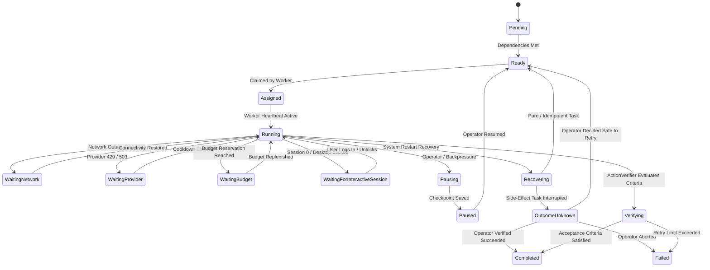

# Durable Execution Engine & State Machine

## 1. Storage & Concurrency Model

The Durable Execution Engine guarantees that any workflow, once accepted, will run to completion or safe containment regardless of software crashes, OS reboots, or hardware interruptions.

### SQLite WAL Mode
- **Concurrency:** Write-Ahead Logging (`PRAGMA journal_mode=WAL;`) allows concurrent readers (Tauri UI, monitoring dæmons) while the background service writes.
- **Synchronous Mode:** `PRAGMA synchronous=NORMAL;` balances ACID durability with high write throughput.
- **Fencing Tokens:** Every task claim and mutation uses monotonic versioning (`retry_count`) to detect and reject stale workers.

## 2. Expanded Task State Machine

Phase 6 introduces resilient states for network, provider, budget, session, and recovery boundaries:



## 3. Atomic Task Claiming

To prevent race conditions among multiple worker threads:
1. Worker queries tasks with `status = 'Ready'`.
2. Worker executes an atomic conditional update:
   ```sql
   UPDATE workflow_tasks
   SET status = 'Running', started_at = datetime('now')
   WHERE id = ?1 AND status = 'Ready'
   ```
3. Only the worker that successfully updates the row proceeds with execution.
