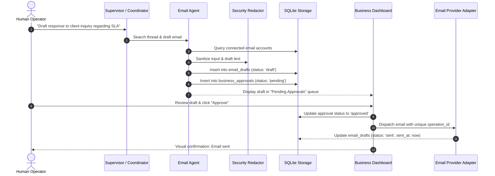

# Email Agent Architecture & Approval Gate
## Universal Autonomous AI Workspace — Phase 05

### 1. Purpose & Guiding Principles

The **Email Agent** provides intelligent communication capabilities: searching message threads, summarizing lengthy email exchanges, drafting professional contextual responses, and preparing outbound dispatches.

Because outbound communications have legal, commercial, and reputational ramifications, the Email Agent is architected under **Strict Boundary Controls**:

> **Non-Negotiable Guardrail**: The Email Agent **NEVER** sends an email directly. Every outbound message is written to an immutable draft queue (`email_drafts`) and registered in the `business_approvals` table. An email is dispatched if and only if a human operator explicitly approves it via the UI.

---

### 2. High-Level Email Lifecycle

---

### 3. Core Capabilities (`agent-core::business::email`)

#### 3.1. Thread Ingestion & Summarization
- Ingests multi-party email chains.
- Identifies participant roles (Sender, Direct Recipients, CC).
- Strips repetitive quoted footer headers and signature blocks.
- Synthesizes core discussion points, action items, and outstanding questions.

#### 3.2. Contextual Draft Generation
- Matches the formality, language, and tone of previous thread exchanges.
- Incorporates data, citations, or attachments provided by Research or Data Analysis agents.
- Formats draft with clean Markdown body and plain-text fallback.

#### 3.3. Idempotency & Operation IDs
Network timeouts or retries can cause catastrophic duplicate emails. Every draft is tagged with a cryptographically unique `operation_id` (UUIDv4).
- The `EmailProviderAdapter` records dispatched `operation_id`s in SQLite before transmitting over the network.
- Duplicate invocations with the same `operation_id` return the existing dispatch receipt without re-sending the message.

---

### 4. Adapter Ecosystem

The `EmailProviderAdapter` trait defines:
- `search_emails(account_id, query, limit)`
- `get_thread(account_id, thread_id)`
- `create_draft(account_id, draft)`
- `send_email(account_id, draft, approval_token)`

#### Concrete Implementations:
1. **`MockTestEmailProvider`**: In-memory, zero-dependency provider for deterministic integration testing and CI. Verifies approval token validation and operation ID tracking.
2. **Standard IMAP / SMTP Connector**: RFC-compliant client for custom enterprise mail servers.
3. **Microsoft Graph & Google Workspace Adapters**: OAuth2-authenticated REST adapters for corporate cloud accounts.
