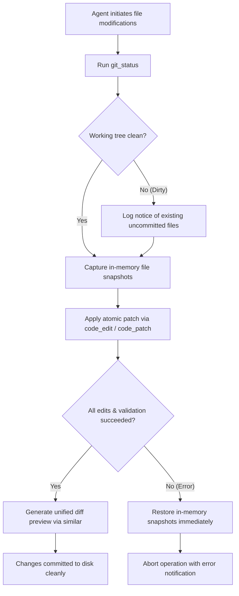

# Git Working Tree Safety & Non-Destructive Principles

## 1. Safety Philosophy

The Universal Autonomous AI Workspace enforces strict working tree protection policies. An autonomous coding agent must never compromise, overwrite, or discard human developer work without unambiguous explicit authorization.

---

## 2. Protected Git Operations & Boundaries

### 2.1 Strictly Barred Automated Commands
The following operations are classified under `PermissionTier::DestructiveAction` and **cannot be executed automatically** by the agent loop:
- `git reset --hard` (destroys uncommitted working directory changes)
- `git clean -fd` / `git clean -fx` (permanently deletes untracked files)
- `git checkout -- .` / `git restore .` (discards unstaged working tree diffs)
- `git push --force` (overwrites remote commit histories)
- `git branch -D` (forces deletion of unmerged branches)

Attempts to invoke these commands trigger an immediate `ApprovalRequired` security interrupt in `agent-security`.

### 2.2 Safe Read-Only Inspection
The agent is granted read-only access to query repository state:
- `git_status`: Checks current branch, staged files, unstaged modifications, and untracked artifacts using `--porcelain=v1 -b`.
- `git_diff`: Computes unified diffs against `HEAD` or staged changes without mutating any files.
- `git_log`: Retrieves commit history (`--oneline --decorate`) within user-configurable limits.

---

## 3. Working Tree Protection Workflow

---

## 4. Rollback & Atomic Backup Mechanics

1. **Pre-Mutation Snapshotting**:
   - Before `code_patch` modifies any file on disk, `agent-tools` reads the existing content of all targeted files and stores them in an in-memory backup dictionary (`backups: HashMap<PathBuf, Option<String>>`).
2. **Failure Interception**:
   - If an I/O error occurs, a directory creation fails, or a permission policy is violated on any subsequent file, the transaction fails immediately.
3. **Atomic Restoration**:
   - The engine iterates through the backup dictionary, restoring all modified files to their exact pre-patch byte content and removing newly created files.
   - The workspace is guaranteed to remain in a pristine, uncorrupted state.
