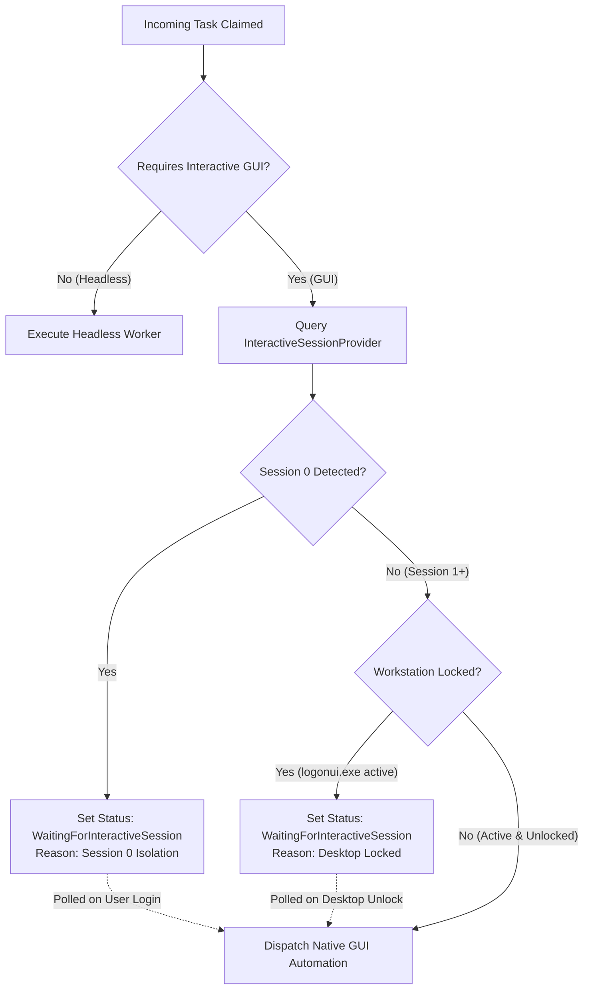

# Interactive Worker Architecture & Session 0 Isolation

## 1. The Windows Session 0 Problem

Since Windows Vista, Windows enforces **Session 0 Isolation**:
- Windows Services execute strictly in **Session 0**, a non-interactive window station.
- Processes running in Session 0 cannot create visible windows, receive hardware mouse/keyboard events, or capture desktop graphics.
- Logged-in interactive users execute in **Session 1, 2, ...**.
- Workstations may also be locked (`logonui.exe` active), during which input injection fails or corrupts target application states.

## 2. WindowsInteractiveWorker Architecture

To allow 24/7 background automations to safely interact with desktop software, the platform decouples tasks into two categories:

| Task Type | Examples | Execution Environment | Session Requirement |
| :--- | :--- | :--- | :--- |
| **Headless** | REST API calls, SQL data crunching, LLM reasoning, file indexing, email drafting | `AgentRuntimeService` | Session 0 or Session 1+ |
| **Interactive GUI** | Windows UI Automation, Win32 mouse/keyboard, active window screenshot, Playwright desktop browser | `WindowsInteractiveWorker` | Session 1+ (Unlocked Desktop) |

## 3. Session Detection & State Machine

### Detection Mechanics
1. **Session ID Query:** Calls Windows API `ProcessIdToSessionId(GetCurrentProcessId(), &session_id)`.
2. **Lock Screen Inspection:** Inspects active processes for `logonui.exe`. When the workstation is locked, Windows launches `logonui.exe`.
3. **Graceful Deferral:** Rather than crashing or timing out, the task enters `WaitingForInteractiveSession`. As soon as the user logs in or unlocks the screen, the worker automatically resumes execution.
