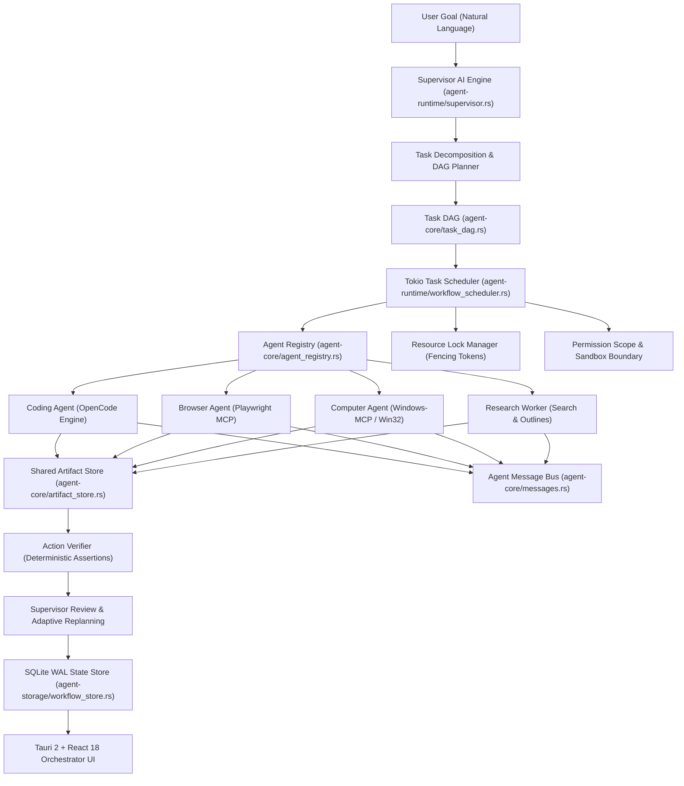

# Multi-Agent Architecture Specification

## 1. Executive Summary
Phase 4 elevates the Universal Autonomous AI Workspace from a single-agent multi-tool runtime into a robust, deterministic, and distributed **Multi-Agent Orchestration System**.

A central **Supervisor AI Engine** analyzes high-level natural language requests, plans and validates an acyclic **Task Directed Acyclic Graph (DAG)**, assigns tasks to specialized workers based on strictly registered capabilities, enforces bounded concurrency and resource locks, shares results through an externalized **Shared Artifact Store**, verifies outcomes with deterministic assertions, and guarantees durability and state recovery via an embedded SQLite WAL database.

---

## 2. Multi-Agent System Topology

---

## 3. Core Architectural Principles

### 3.1 Separation of Planning and Execution
- The **Supervisor Agent** does not directly mutate files, click buttons, or run shell scripts.
- The Supervisor is reserved strictly for goal analysis, DAG planning, task decomposition, and milestone review.
- The **Task Scheduler** manages execution deterministically in Rust without invoking LLMs for mechanical operations like dependency checks, progress percentages, or lease renewals.

### 3.2 Capability-Based Task Delegation
- Every worker registers its actual functional capabilities (`CodeEditing`, `BrowserNavigation`, `DesktopWindowControl`, `WebSearch`).
- The Scheduler rejects any assignment where the target worker lacks the requisite capability.

### 3.3 Zero-Context-Pollution & Artifact Reference Passing
- Multi-agent collaboration does not concatenate chat histories.
- Workers return structured summaries and compact `ArtifactRef`s (SHA-256 hash, URI, type, byte size, preview). Downstream workers load specific artifacts by reference.

### 3.4 Bounded Concurrency & Fair Resource Allocation
- Worker concurrency is strictly bounded (default 1-4 concurrent tasks).
- Interactive Desktop control is restricted to a single exclusive controller via `ResourceLockManager`.
- Conflicting file mutations on identical file paths are blocked by file-level leases with monotonic fencing tokens.
