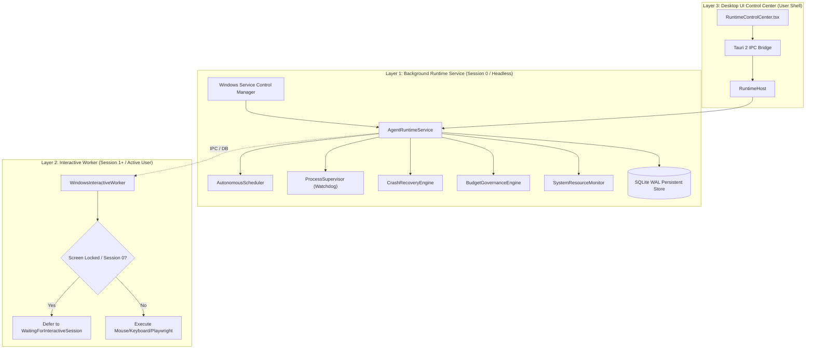

# Persistent Runtime Architecture (Phase 6)

## 1. Architectural Overview

Phase 6 transitions the Universal Autonomous AI Workspace from an interactive desktop application into a resilient, **24/7 autonomous runtime platform**. The architecture decouples the execution of long-running workflows, background automations, scheduled maintenance, and data pipelines from the presence or lifecycle of the desktop GUI window.

The system is structured across three distinct operational layers:

## 2. Layer Responsibilities

### Layer 1: AgentRuntimeService (Headless Service)
- **Host Process:** Registered as a Windows Service (`AAIRuntime`) or runs in headless daemon mode.
- **Independence:** Survives Desktop UI crashes, window minimization, user logout, and terminal disconnects.
- **Core Components:**
  - `AutonomousScheduler`: Evaluates intervals, cron expressions, and missed-run policies.
  - `ProcessSupervisor`: Monitors health of worker processes (MCP servers, Python engines, compilers).
  - `CrashRecoveryEngine`: Runs on startup to reconcile in-flight workflows and flag uncertain side effects.
  - `BudgetGovernanceEngine`: Pre-allocates token and monetary limits before worker dispatch.
  - `SystemResourceMonitor`: Real-time tracking of CPU, RAM, and disk storage to enforce backpressure.

### Layer 2: WindowsInteractiveWorker (Session 1+ Desktop Bridge)
- **Windows Session 0 Isolation:** Windows prevents Session 0 services from displaying UI or intercepting input.
- **Worker Architecture:** GUI-dependent actions (mouse clicks, keyboard strokes, window activations, desktop screenshots) are routed through `WindowsInteractiveWorker`.
- **Safety Checks:**
  - Queries `ProcessIdToSessionId` to detect if execution is within Session 0.
  - Inspects `logonui.exe` presence to detect if the workstation is locked.
  - If locked or in Session 0, transitions task status to `WaitingForInteractiveSession` instead of failing.

### Layer 3: Desktop UI Control Center
- **Operator Interface:** Hosted inside `RuntimeControlCenter.tsx`.
- **Capabilities:**
  - Real-time SCM service lifecycle management (Install, Start, Stop, Restart, Status).
  - Autonomous Scheduler inspection, manual triggering, and job creation.
  - Watchdog process table with CPU/RAM metrics and manual kill options.
  - Crash recovery operator queue for reconciling `OutcomeUnknown` side effects.
  - Instant online database backup and snapshot management.
