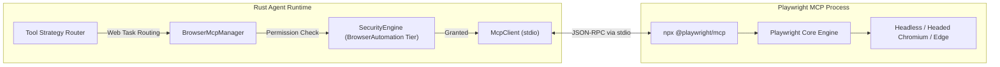

# Playwright MCP Integration Architecture & Specification
**Universal Autonomous AI Workspace — Phase 3**
**Component:** Browser Automation & Web Interaction Subsystem

---

## 1. Overview & Upstream Provenance
`Playwright MCP` is the official Model Context Protocol server for Playwright, developed by Microsoft Playwright team and open-source contributors under the Apache-2.0 License.

- **Package:** `@playwright/mcp` (Version `0.0.83` / Playwright `1.64.0-alpha`)
- **Transport:** stdio JSON-RPC 2.0 (standard for local MCP tools)
- **License:** Apache-2.0 License
- **Runtime:** Node.js v18+ (tested and verified with Node.js v24.11.1)

---

## 2. Integration Architecture in Rust

### 2.1 Communication & Process Lifecycle
1. **Invocation**: Launched via `npx -y @playwright/mcp` with configured options (`--isolated`, `--browser chromium`).
2. **MCP Handshake**: Initializes protocol version `2024-11-05`, receives server capabilities, and discovers 25 browser automation tools.
3. **Session Management**: Maintains active browser context, tracking open pages, current URL, and navigation state.
4. **Security Enforcement**: File uploads and downloads are strictly restricted to the authorized workspace root. Navigation to internal network endpoints or malicious protocols is blocked according to `SecurityEngine` policies.
5. **Session Teardown**: Upon task completion or emergency stop, issues `browser_close` and terminates the child process cleanly.

---

## 3. Discovered Tools & Capabilities

| Tool Name | Key Parameters | Functionality | Strategy Tier |
|---|---|---|---|
| `browser_navigate` | `url`, `timeout` | Navigates to target URL, waits for load state | Tier 4 (Web Navigation) |
| `browser_navigate_back` | None | Emulates browser back button | Tier 4 (Web Navigation) |
| `browser_snapshot` | None | Captures DOM accessibility snapshot with element ref IDs | Tier 4 (DOM Observation) |
| `browser_click` | `selector` or `element_id` | Simulates mouse click on target element | Tier 4 (DOM Action) |
| `browser_type` / `browser_fill_form` | `selector`, `text` | Types text into input fields, textareas | Tier 4 (DOM Action) |
| `browser_select_option` | `selector`, `values` | Selects dropdown options | Tier 4 (DOM Action) |
| `browser_press_key` | `key` | Dispatches keyboard events (`Enter`, `Tab`, `Escape`) | Tier 4 (DOM Action) |
| `browser_file_upload` | `selector`, `file_paths` | Uploads files within workspace sandbox | Tier 4 (DOM Action) |
| `browser_tabs` | `action`: `list`, `new`, `select`, `close` | Multi-tab orchestration and switching | Tier 4 (Tab Management) |
| `browser_wait_for` | `selector`, `state` | Explicit synchronization until DOM condition is met | Tier 4 (Synchronization) |
| `browser_take_screenshot` | `full_page`, `format` | Visual capture of web viewport (fallback only) | Tier 6 (Visual Fallback) |
| `browser_close` | None | Terminates browser session cleanly | Tier 4 (Lifecycle) |

---

## 4. Token Efficiency in Browser Automation
Instead of passing full page HTML or multi-megabyte screenshots:
1. **DOM Accessibility Snapshot (`browser_snapshot`)**:
   Playwright MCP produces a structural accessibility tree (role, name, value, ref IDs) instead of raw verbose HTML. This reduces token size by 80–90%.
2. **Pruning & Depth Limiting**:
   Non-interactive container nodes (`
`, `` without semantics) are collapsed, preserving only actionable widgets (buttons, inputs, links, forms).
3. **Observation Delta**:
   When consecutive actions are performed on the same page, only DOM mutations (nodes added, removed, or changed) are sent to the LLM.
