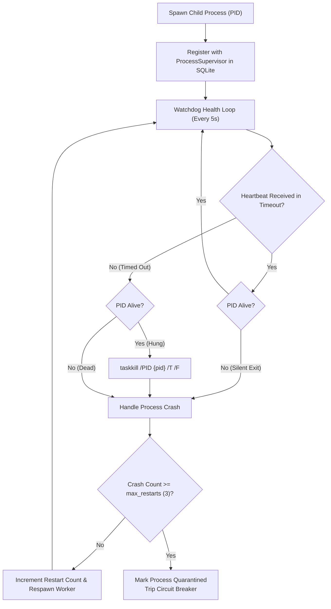

# Process Supervisor & Watchdog Architecture

## 1. Overview

The `ProcessSupervisor` maintains continuous oversight over external worker processes spawned by the workspace, including:
- Windows-MCP Server (`windows-mcp`)
- Playwright-MCP Browser Server (`playwright-mcp`)
- OpenCode AST Indexer & Language Server
- Python Data Analysis Workers

## 2. Supervision Mechanism

## 3. Crash Loop Circuit Breaker
- **Threshold:** Maximum 3 restarts within a rolling 60-second window.
- **Quarantine Mode:** When the threshold is exceeded, the process status transitions to `Quarantined`.
- **Safety:** The supervisor refuses to restart a quarantined process automatically, preventing resource exhaustion, disk flooding, or CPU thrashing.
- **Operator Intervention:** The Desktop UI Control Center displays quarantined workers with full stack logs and a "Reset & Retry" action.

## 4. Process Tree Termination
When terminating a supervised process, standard `kill` operations can leave orphan worker subprocesses (e.g. node.exe, chromium.exe).
The supervisor executes **process tree termination**:
- **Windows:** `taskkill.exe /PID <pid> /T /F` kills the process and all child processes recursively.
- **Unix:** Group kill `kill(-pid, SIGKILL)` targets the entire process group.
