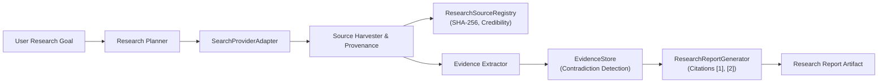

# Research Agent Architecture & Capabilities
## Universal Autonomous AI Workspace — Phase 05

### 1. Purpose & Responsibilities

The **Research Agent** is an autonomous intelligence specialist designed to conduct systematic, rigorous research across internal workspaces and external web endpoints. It replaces unstructured search queries with an evidence-grounded, verifiable research methodology.

Key responsibilities:
- Formulate targeted queries from high-level natural language questions.
- Execute searches across registered search providers (local workspace index, mock providers, and enterprise search APIs).
- Extract textual evidence, factual claims, and quantitative statistics.
- Verify source provenance and calculate content integrity hashes (SHA-256).
- Detect and flag contradictions between conflicting sources.
- Synthesize findings into structured research reports with numeric bracketed citations (`[1]`, `[2]`).

---

### 2. Core Architecture (`agent-core::research`)



---

### 3. Key Data Structures

#### 3.1. Research Source (`ResearchSource`)
```rust
pub struct ResearchSource {
    pub id: String,
    pub title: String,
    pub url_or_path: String,
    pub source_type: String, // "web", "file", "document", "api"
    pub credibility_score: f64, // 0.0 - 1.0
    pub content_hash: String, // SHA-256
    pub accessed_at: i64,
    pub snippet: Option<String>,
}
```

#### 3.2. Evidence Item (`EvidenceItem`)
```rust
pub struct EvidenceItem {
    pub id: String,
    pub source_id: String,
    pub claim: String,
    pub context_quote: String,
    pub confidence_score: f64,
    pub contradiction_with: Option<String>, // ID of conflicting evidence item
    pub extracted_at: i64,
}
```

---

### 4. Search Providers & Pluggable Architecture

The Research Agent interfaces with search mechanisms via the `SearchProviderAdapter` trait:
- `search(query: &str, max_results: usize) -> Result<Vec<SearchResult>, String>`
- Implementations:
  1. **`LocalWorkspaceSearchProvider`**: Scans the active project workspace (`walkdir`), filters relevant source files, documents, and notes, and returns matching context blocks.
  2. **`MockWebSearchProvider`**: High-performance, offline-deterministic mock search engine for automated testing and CI verification.
  3. **Enterprise Web Adapter**: Future extensibility point for Google Search, Bing, or Perplexity APIs.

---

### 5. Contradiction Detection Algorithm

When evidence items are ingested into the `EvidenceStore`, quantitative and qualitative claims are evaluated across sources:
1. Claims with numeric values regarding common entities (e.g., market growth, prices, dates) are parsed.
2. If two sources assert quantitative metrics for the same metric with a divergence exceeding 15%:
   $$\Delta = \frac{|v_1 - v_2|}{\max(v_1, v_2)} > 0.15$$
3. Both evidence items have their `contradiction_with` field linked to each other.
4. When generating reports, contradicting claims are highlighted in a dedicated **"Identified Discrepancies & Contradictions"** section for user review.

---

### 6. Verifiable Citations

Every statement generated by the Research Agent must cite one or more source IDs:
```markdown
Autonomous coding agents reduced task resolution time by 42% in Q3 [1].
However, legacy codebases with minimal test coverage exhibited a higher initial failure rate [2].

## Sources & Citations
- [1] "State of AI Engineering 2026", https://example.org/report (Accessed: 2026-10-21)
- [2] "Enterprise Refactoring Study", D:\DATA\source\AIcode\aai\docs\CODING_AGENT_ARCHITECTURE.md (Accessed: 2026-10-21)
```
Ungrounded assertions without corresponding evidence records in `agent-storage::business_store` are rejected during the validation phase.
