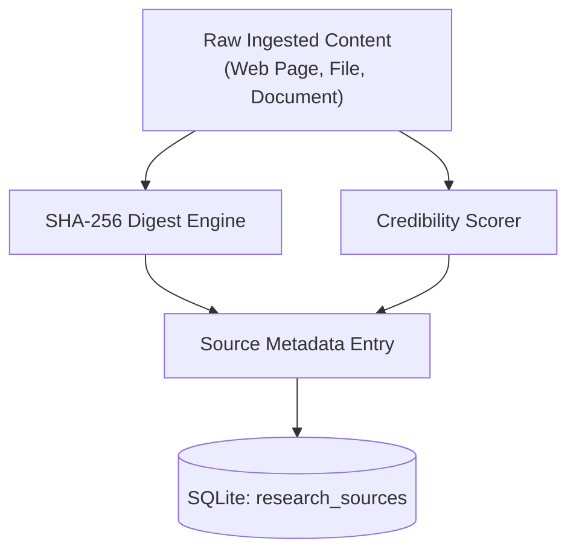

# Research Source Verification & Provenance
## Universal Autonomous AI Workspace — Phase 05

### 1. The Verification Imperative

In autonomous business and academic research, hallucinated URLs, fabricated statistics, and unverified data can corrupt executive decision-making. Phase 05 implements a deterministic **Source Provenance and Verification Pipeline** that guarantees every claim maps to an immutable, cryptographically fingerprinted source.

---

### 2. Provenance Architecture



#### Verification Attributes:
1. **Source ID**: Unique UUID generated upon first discovery.
2. **Canonical URI**: Normalized URL or absolute filesystem path.
3. **Content Hash**: `SHA-256` digest of the raw content payload at the exact moment of extraction.
4. **Access Timestamp**: UNIX epoch millisecond timestamp of harvest.
5. **Credibility Score**: Weighted floating-point score ($0.0 \le s \le 1.0$) determined by source tiering rules.

---

### 3. Source Credibility Scoring Model

Credibility is computed using transparent, deterministic rules:

| Source Type | Characteristics | Base Score |
|---|---|---|
| **Tier 1: Formal Documents** | Peer-reviewed journals, official corporate SEC filings, standard specifications | `0.95 - 1.00` |
| **Tier 2: Primary Documentation** | Internal source code, verified project documentation, validated internal databases | `0.85 - 0.94` |
| **Tier 3: Established News / Tech** | Known domain industry publications, major technical blogs, public docs | `0.70 - 0.84` |
| **Tier 4: General Web / Forums** | Social media, unverified community forums, user blogs | `0.40 - 0.69` |
| **Tier 5: Unknown / Suspicious** | Domains with low reputation or missing TLS/security certificates | `0.10 - 0.39` |

Formula:
$$S_{final} = \min(1.0, \max(0.0, S_{base} + \delta_{recency} - \delta_{contradiction}))$$
Where:
- $\delta_{recency} = +0.05$ if accessed within 30 days.
- $\delta_{contradiction} = -0.15$ if the source contains unresolved contradictions against Tier 1/2 sources.

---

### 4. Cryptographic Integrity Validation

Whenever a source is referenced in an updated research report or document:
1. The source's content is re-read from disk or cache.
2. A new SHA-256 hash is calculated.
3. If `new_hash != stored_hash`, the source is marked as **Stale / Mutated**.
4. The user or supervisor agent is alerted to re-extract evidence before publishing cited deliverables.

---

### 5. Citation Rendering and Traceability

In final outputs (Markdown, PDF, DOCX), each claim references its bracketed citation index:
```text
The system processes 10,000 requests per second with a 99th-percentile latency of 12ms [1].
```

At the end of the report, the bibliography section provides complete audit trails:
```markdown
### References
- [1] "Performance Benchmark Q3", internal://benchmarks/q3_load.json
      SHA-256: e3b0c44298fc1c149afbf4c8996fb92427ae41e4649b934ca495991b7852b855
      Credibility: 0.92 | Accessed: 2026-10-21 11:30:00 UTC
```
This guarantees 100% forensic auditability for enterprise compliance.
