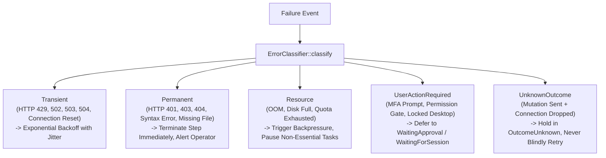
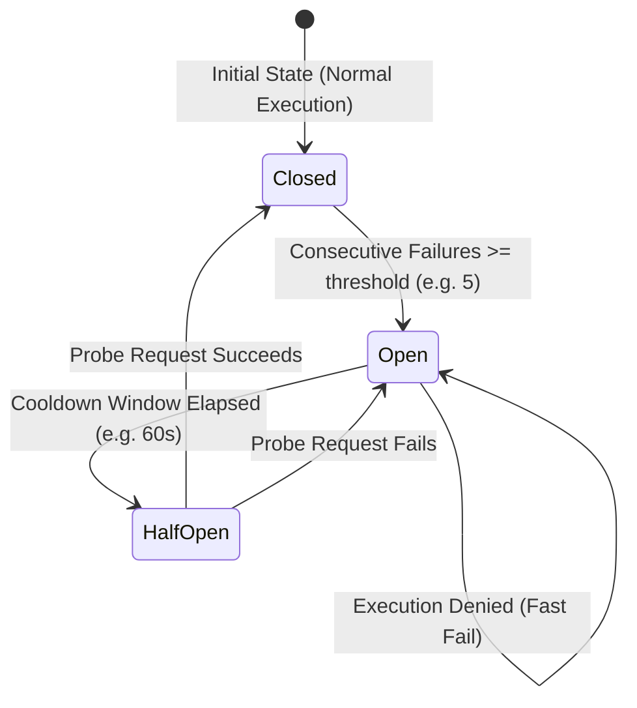

# Resilience Patterns & Circuit Breakers

## 1. Error Classification Engine

The `ErrorClassifier` categorizes all operational and tool failures into distinct classes to dictate deterministic recovery workflows:

## 2. Circuit Breaker State Machine

To prevent cascading failures across the multi-agent mesh, providers and workers are protected by `CircuitBreaker`:

### Parameters
- **Failure Threshold:** 3 to 5 consecutive failures.
- **Cooldown Window:** 30 to 120 seconds.
- **Probe Concurrency:** Exactly 1 probe request in `HalfOpen` state.
