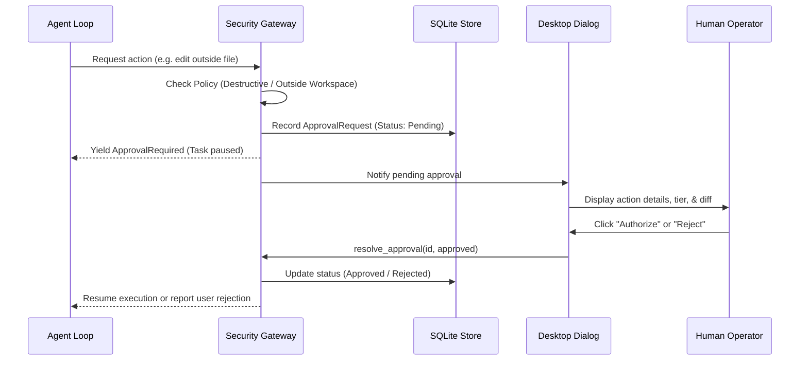

# Security & Permission Model

## 1. Security Architecture Principles

1. **Centralized Tool Gateway**: Permissions are checked at the tool execution gateway (`SecurityEngine`), never relying on model self-compliance.
2. **Principle of Least Privilege**: The agent operates inside a strictly scoped workspace directory by default.
3. **Defense in Depth**: Destructive actions and out-of-boundary access require explicit human authorization.
4. **Emergency Stop**: An instant, top-level kill switch immediately halts all ongoing and queued operations.

---

## 2. Permission Tiers

| Tier | Description | Default Policy |
| :--- | :--- | :--- |
| `ReadOnly` | Reading files within workspace, listing directories, reading environment metadata | Allowed |
| `WorkspaceWrite` | Creating, updating, or patching files within workspace boundary | Auto in `WorkspaceAuto` / `FullAuto`; Approval in `Strict` |
| `ShellExecution` | Executing CMD or PowerShell commands | Auto in `FullAuto` (safe cmds); Approval in `Strict` & `WorkspaceAuto` |
| `DesktopControl` | Interacting with GUI, moving mouse, keyboard input via Windows-MCP | Requires Approval |
| `DestructiveAction` | Deleting files, modifying files outside workspace, dangerous shell commands (`format`, `rmdir /s`, `shutdown`) | Always Requires Human Approval |
| `ExternalSideEffect` | Network deployment, payment, external email | Always Requires Human Approval |

---

## 3. Sandboxing & Boundary Validation

- Workspace paths are canonicalized and normalized (handling Windows UNC prefixes `\\?\` and case-insensitive comparison).
- The `is_within_boundary(workspace_root, target_path)` check ensures that path traversal attempts (e.g. `..\..\Windows\System32`) are detected and intercepted as out-of-boundary requests.

---

## 4. Human-in-the-Loop Approval Flow

---

## 5. Dangerous Command Filtering
The security engine flags commands containing signatures of destructive operations, including:
- `rmdir /s /q`
- `del /f /s /q`
- `format`
- `shutdown`
- `Remove-Item -Recurse -Force`
- `reg delete`
- Fork bomb patterns (`:(){ :|:& };:`)

Any such command triggers an immediate `ApprovalRequired` halt regardless of operating mode.
