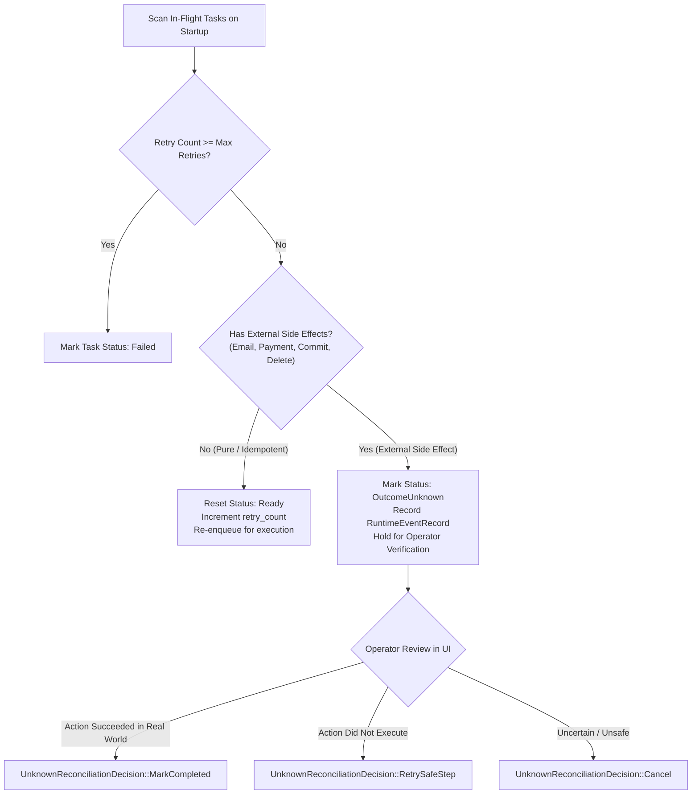

# Self-Recovery Engine & Side-Effect Containment

## 1. Startup Crash Reconciliation

When `AgentRuntimeService` starts, the `CrashRecoveryEngine` scans the SQLite database for tasks left in an in-flight state (`Running`, `Assigned`, `Checkpointing`).

The engine classifies each interrupted task based on whether it entails **external side effects**:

## 2. Preventing Duplicate Side Effects
Blindly retrying tasks after a power cut or crash is catastrophic for external mutations:
- Sending duplicate emails to customers.
- Double-charging credit cards or initiating duplicate bank transfers.
- Deleting files twice or committing broken git branches.

By placing interrupted side-effect tasks into `OutcomeUnknown`, the system guarantees **at-most-once execution** for non-idempotent operations until human operator verification.

## 3. Operator Reconciliation Actions
Inside `RuntimeControlCenter.tsx` (Recovery tab), operators can review held tasks and apply one of three decisions:
1. `RetrySafeStep`: Resets the task to `Ready` and increments `retry_count`.
2. `MarkCompleted`: Marks the task `Completed` and allows downstream dependent tasks to unblock.
3. `Cancel`: Marks the task `Failed` / `Cancelled` and safely halts the workflow DAG.
