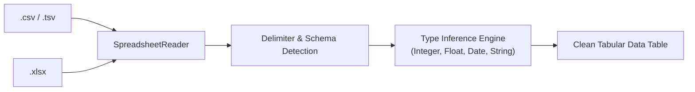

# Spreadsheet Processing Architecture
## Universal Autonomous AI Workspace — Phase 05

### 1. Ingestion Overview

The spreadsheet engine handles both tabular plain-text formats (CSV, TSV) and binary/zipped spreadsheet packages (Microsoft Excel `.xlsx`).

---

### 2. Format Handling

#### 2.1. CSV & Delimited Text
- **Auto-Detection**: Evaluates sample rows against candidate delimiters (`,`, `;`, `\t`, `|`). Selects the delimiter that produces the most consistent column counts.
- **RFC 4180 Compliance**: Correctly handles escaped quotes (`""`), commas within quoted strings, and multi-line cell values.
- **Streaming Mode**: Large CSV files (> 100MB) can be processed row-by-row with minimal RAM footprint.

#### 2.2. Microsoft Excel OpenXML (.xlsx)
- **ZIP Packaging**: Reads the `.xlsx` ZIP container using the `zip` crate.
- **Shared Strings**: Parses `xl/sharedStrings.xml` to build the string lookup table used across worksheets.
- **Worksheet Extraction**: Reads `xl/worksheets/sheet1.xml` (and subsequent sheets), maps cell references (`A1`, `B2`), decodes inline formulas and cached calculation results, and reconstructs the tabular grid.

---

### 3. Automatic Type Inference & Data Cleaning

Incoming raw spreadsheet values are strings. `SpreadsheetReader` runs heuristic type inference per column:

1. **Integer Detection**: Matches regular integer patterns (`^-?[0-9]+$`).
2. **Float / Currency**: Matches floating-point values, stripping currency symbols (`$`, `€`, `₫`, `¥`) and thousands separators (`,` or `.`).
3. **Boolean**: Matches `true`/`false`, `yes`/`no`, `1`/`0`.
4. **Date / Timestamp**: Parses ISO-8601 (`YYYY-MM-DD`) and common locale formats (`DD/MM/YYYY`).
5. **Fallback**: Categorical String.

Missing values (`""`, `"N/A"`, `"null"`, `"-"`) are flagged as `None` to prevent skewing statistical computations.

---

### 4. Memory & Performance Safeguards

To prevent spreadsheet-based denial of service:
- **Maximum Cell Limit**: Default cap of 1,000,000 cells per workbook. Datasets exceeding this trigger automatic sampling or partition warnings.
- **Truncated Previews**: UI previews load the first 100 rows, while analytical metrics run over the full dataset in background threads.
- **Zero External Runtimes**: Zero reliance on Python Pandas, Excel COM automation, or Node.js scripts. Pure, native Rust execution.
