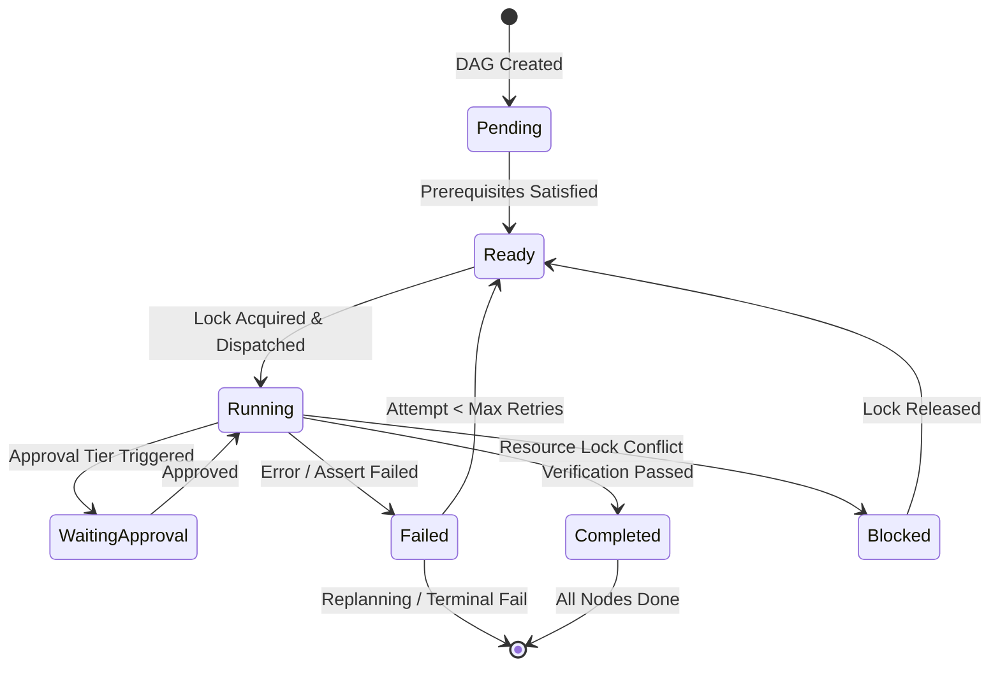

# Task Scheduler & Dispatcher Specification

## 1. Overview
The `WorkflowScheduler` (`agent-runtime/src/workflow_scheduler.rs`) is the core asynchronous orchestration engine executing multi-agent tasks concurrently within strict bounds.

---

## 2. Scheduling Lifecycle & State Transitions

---

## 3. Concurrency & Fairness Control
- **Bounded Worker Pool**: Concurrency ceiling (default 1 to 4 concurrent tasks, configurable via `max_concurrent_tasks`).
- **Tokio Multi-threaded Runtime**: Tasks execute in lightweight asynchronous tasks without blocking the UI thread.
- **Fairness & Prioritization**: Ready tasks with higher numeric priority are dequeued before lower-priority tasks, avoiding starvation of critical path items.

---

## 4. Cancellation & Pause Semantics
- **Atomic Cancellation**: Setting `cancel_flag` terminates pending task dispatch, signals running workers to abort child processes, safely releases resource locks, and marks the workflow `Cancelled`.
- **Checkpoint Pause**: Setting `pause_flag` safely allows in-progress atomic writes to complete, avoids launching new steps, and transitions the workflow to `Paused`.
