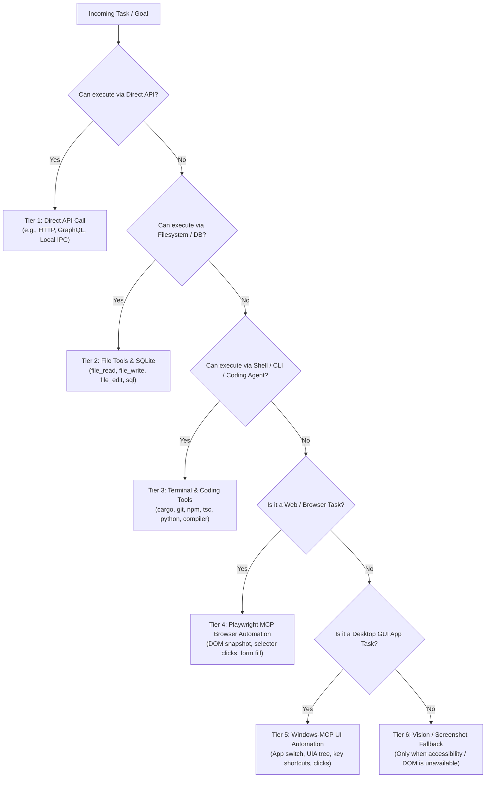

# Smart Tool Strategy Router Specification
**Universal Autonomous AI Workspace — Phase 3**
**Subsystem:** Intelligent Multi-Tier Tool Routing & Fallback Engine

---

## 1. Routing Principles
A common pitfall in AI computer agents is the overuse of high-cost, brittle GUI interactions (such as moving the mouse and clicking pixels) for tasks that could be accomplished in milliseconds via a direct API call or CLI command.

The `ToolStrategyRouter` enforces a **6-Tier Priority Routing Model**:
Always choose the most efficient, deterministic, and token-light tool available for a given goal.



---

## 2. Priority Tier Details

### Tier 1 — Direct API
- **Ideal For**: Querying weather, fetching JSON APIs, communicating with local service endpoints.
- **Why**: Zero rendering overhead, sub-second latency, deterministic JSON structures.

### Tier 2 — Filesystem & SQLite
- **Ideal For**: Reading project files, creating configuration, writing scripts, inspecting databases.
- **Why**: Direct OS file I/O is 100x faster and infinitely more reliable than opening File Explorer and clicking menus.

### Tier 3 — Shell / CLI & Coding Agent
- **Ideal For**: Compiling code (`cargo build`, `npm run build`), running unit tests, inspecting Git working trees, installing dependencies.
- **Why**: Standard streams (stdout/stderr) and exit codes provide crystal-clear machine-readable diagnostics.

### Tier 4 — Playwright MCP Browser Automation
- **Ideal For**: Web browsing, testing web applications, filling HTML forms, interacting with modern web portals.
- **Why**: DOM accessibility trees and element refs (`browser_snapshot`) provide reliable targeting without screen resolution dependencies.

### Tier 5 — Windows-MCP UI Automation
- **Ideal For**: Native Windows desktop applications (Notepad, Word, Calculator, settings dialogs).
- **Why**: Windows UI Automation (UIA) maps buttons and edit fields directly, avoiding pixel guessing.

### Tier 6 — Vision & Screenshot Fallback
- **Ideal For**: Visual elements lacking accessibility metadata (Canvas, WebGL, video players, custom owner-drawn controls).
- **Cost**: High token consumption (~1,000–2,500 tokens per image) and higher latency. Kept as the ultimate fallback.

---

## 3. Router Decision Logging
For transparency and QA auditability, every routing decision produces a structured record:
```json
{
  "task": "Create HTML file and verify page title in browser",
  "selected_strategy": "Hybrid",
  "steps": [
    { "step": 1, "tier": 3, "tool": "file_write", "reason": "Creating HTML file via filesystem is faster than typing into editor" },
    { "step": 2, "tier": 3, "tool": "terminal_execute", "reason": "Starting local HTTP server via CLI" },
    { "step": 3, "tier": 4, "tool": "browser_navigate", "reason": "Web page verification routed to Playwright DOM" }
  ]
}
```
