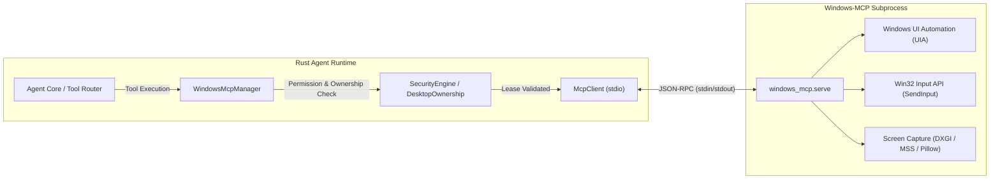

# Windows-MCP Integration Architecture & Specification
**Universal Autonomous AI Workspace — Phase 3**
**Component:** Windows Desktop Automation & UI Automation Subsystem

---

## 1. Overview & Upstream Provenance
`Windows-MCP` is an open-source MCP server developed by CursorTouch (Jeomon George), licensed under the MIT License.
It provides comprehensive native integration with Windows 10/11 through the Model Context Protocol (MCP) using standard stdio JSON-RPC transport.

- **Upstream Repository:** `https://github.com/CursorTouch/Windows-MCP`
- **Inspected Version:** `0.8.8` (Manifest version `0.4`)
- **Runtime Environment:** Python 3.14+ managed via `uv` or system Python
- **License:** MIT License

---

## 2. Integration Architecture in Rust

### 2.1 Communication Lifecycle
1. **Prerequisite Check**: Before launch, `WindowsMcpManager` checks for Python 3.14+ and `uv`.
2. **Process Spawning**: Spawns `uv run --with windows-mcp windows-mcp` or `python -m windows_mcp serve`.
3. **MCP Initialization**: Handshakes via `initialize` method conforming to MCP Protocol specification `2024-11-05`, then emits `notifications/initialized`.
4. **Tool Discovery**: Executes `tools/list` to populate dynamic tool definitions (`windows_mcp_*`).
5. **Execution & Auditing**: Before each call, `SecurityEngine` validates permission and active desktop ownership. Every tool execution is recorded in the SQLite audit log.
6. **Graceful Shutdown**: On application close or emergency stop, signals SIGTERM/kill to the subprocess and cleans up pipe handles.

---

## 3. Toolset & Operational Capabilities

| Tool Name | Subcommands / Modes | Description | Strategy Tier |
|---|---|---|---|
| `windows_mcp_ControlStatus` | Query | Reports if AI or user controls desktop, and idle countdown | Tier 5 (GUI Control) |
| `windows_mcp_App` | `launch`, `resize`, `switch` | Launches executables, brings windows to focus, resizes window rectangles | Tier 5 (GUI Control) |
| `windows_mcp_Snapshot` | Textual Tree / Bounding Boxes | Extracts full UI Automation accessibility hierarchy (buttons, edits, menus) | Tier 5 (GUI Observation) |
| `windows_mcp_Screenshot` | Fast Capture | Captures desktop screen (downscaled for token budget) | Tier 6 (Visual Fallback) |
| `windows_mcp_Click` | `left`, `right`, `middle`, `double` | Clicks at coordinates [x, y] or UI element label | Tier 5 (GUI Interaction) |
| `windows_mcp_Type` | Text input, clear, enter | Types keyboard sequences, clears fields, sends Return key | Tier 5 (GUI Interaction) |
| `windows_mcp_Move` | Move, Drag-and-drop | Moves mouse cursor or drags between coordinates | Tier 5 (GUI Interaction) |
| `windows_mcp_Scroll` | Vertical, Horizontal | Scrolls content using mouse wheel simulation | Tier 5 (GUI Interaction) |
| `windows_mcp_Shortcut` | Key combos | Dispatches system shortcuts (`ctrl+c`, `ctrl+v`, `alt+tab`) | Tier 5 (GUI Interaction) |
| `windows_mcp_WaitFor` | Polling conditions | Awaits text, window title, or element appearance in a single call | Tier 5 (GUI Synchronization) |
| `windows_mcp_Clipboard` | `get`, `set` | Reads or writes text to the Windows OS clipboard | Tier 5 (GUI Clipboard) |
| `windows_mcp_Process` | `list`, `kill` | Inspects running processes or terminates hanging tasks | Tier 5 (System Management) |

---

## 4. Safety, Ownership & Desktop Lock Handling

1. **Desktop Ownership Lease**:
   The AI cannot send input blindly. It must acquire a time-bounded lease from `DesktopOwnershipManager`. If the user moves the mouse or types, user takeover is triggered, suspending AI inputs.
2. **Workstation Lock Detection**:
   When the desktop is locked (`LockWorkstation` or UAC secure desktop), Windows-MCP reports locked state or fails UI element binding gracefully. The agent does not send blind mouse/keyboard input and transitions to waiting or reports status.
3. **Emergency Stop**:
   Pressing the Emergency Stop button in the UI revokes the lease, drops input synthesis immediately, and releases the cursor.
