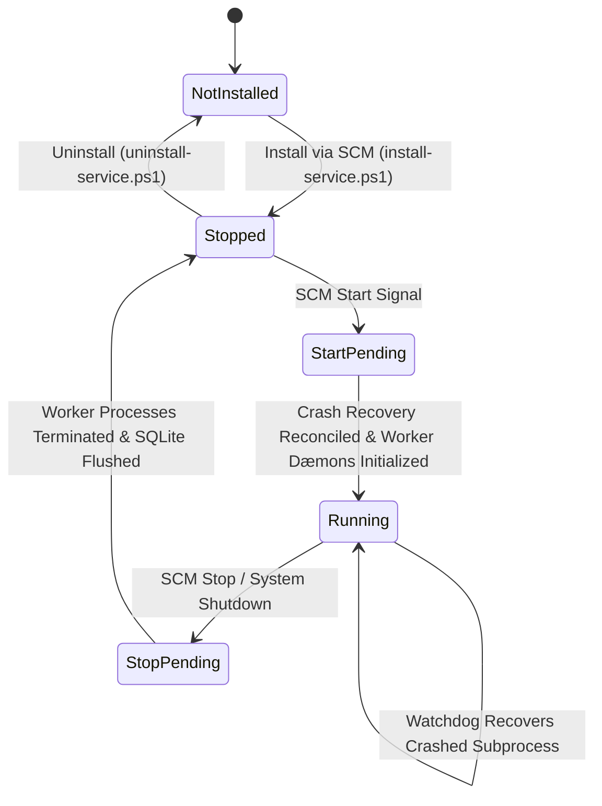

# Windows Service Architecture & SCM Integration

## 1. Windows Service Control Manager (SCM) Integration

The Universal Autonomous AI Workspace integrates directly with the native Windows Service Control Manager via the `windows-service` Rust crate (version 0.8) and Windows API abstractions.

### Service Identification & Parameters
- **Service Name:** `AAIRuntime`
- **Display Name:** `Universal Autonomous AI 24/7 Runtime Service`
- **Service Type:** `SERVICE_WIN32_OWN_PROCESS`
- **Default Startup Type:** `SERVICE_AUTO_START` (Automatic on Windows boot)
- **Error Control:** `SERVICE_ERROR_NORMAL`
- **Binary Launch Arguments:** `desktop.exe --service`

## 2. Windows Service Lifecycle



## 3. SCM Service Control Handler

The service entry point implements the Windows Service main loop:
1. **Registration:** Registers `service_control_handler` to accept control codes:
   - `SERVICE_CONTROL_STOP`: Initiates graceful draining of active queues.
   - `SERVICE_CONTROL_SHUTDOWN`: Triggers emergency SQLite WAL checkpointing.
   - `SERVICE_CONTROL_INTERROGATE`: Responds with current state and health metrics.
2. **State Updates:** Reports `SERVICE_START_PENDING`, `SERVICE_RUNNING`, `SERVICE_STOP_PENDING`, and `SERVICE_STOPPED` to the Windows SCM.
3. **Recovery Actions:** Configured with SCM failure recovery:
   ```cmd
   sc.exe failure AAIRuntime reset= 86400 actions= restart/60000/restart/60000/restart/60000
   ```
   If the service crashes, Windows automatically restarts it after 60 seconds (up to 3 times in 24 hours).

## 4. Cross-Environment Abstraction

To ensure testability and multi-platform compatibility, the system defines the `RuntimeServiceAdapter` trait in `agent-platform`:
- `WindowsServiceAdapter`: Native Windows implementation using `windows-service` 0.8.
- `MockServiceAdapter`: In-memory thread-safe state machine used in automated CI/CD and non-Windows test runners.
