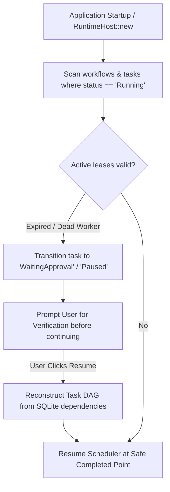

# Durable Workflow & Crash Recovery Specification

## 1. Overview
The durability subsystem guarantees that multi-step workflows survive unexpected process termination, system reboots, and power loss without corrupting state or blindly re-executing unsafe side effects.

---

## 2. Storage Model
All orchestration entities are persisted transactionally in SQLite with Write-Ahead Logging (WAL):
- `workflows`: Global status and token accounting.
- `workflow_tasks`: Execution milestones, errors, and output payloads.
- `task_dependencies`: Directed edges and condition rules.
- `task_attempts`: Historical attempts, durations, and exit codes.
- `shared_artifacts`: File paths and SHA-256 integrity hashes.
- `resource_leases`: Active leases and fencing tokens.

---

## 3. Crash Recovery Protocol

### Safety Rule on Side-Effects
The system **never** automatically replays unconfirmed external side effects (form submissions, file deletions, code publishing, or shell execution) upon recovery. Interrupted actions pause for human review.
